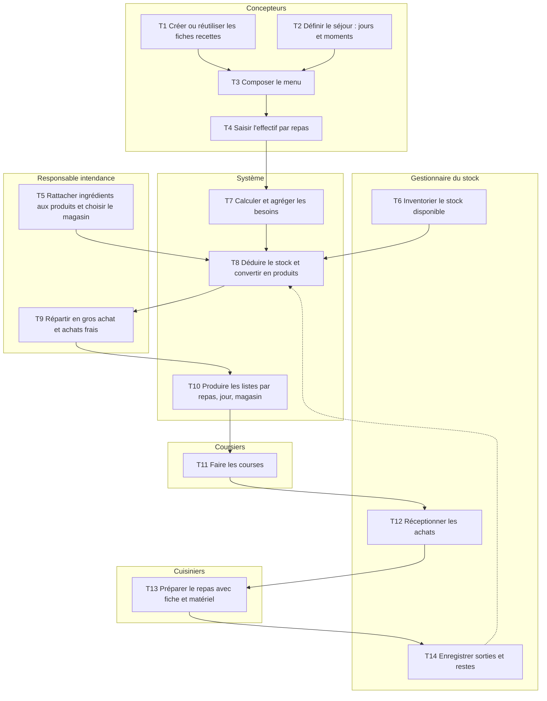

# Discovery Brief — Menus et courses de séjour

Oct 24, 2026 · @Houssam

## Résumé

L'intendance de séjours (tous types) repose aujourd'hui sur un tableur où l'agrégation des ingrédients et la conversion en produits à acheter se font à la main. Le besoin est de passer d'un menu (jours × moments) composé à partir d'une bibliothèque de recettes (quantités pour 10 personnes) à des listes de courses exactes, ajustées à l'effectif de chaque repas et au stock disponible. Les listes sont consultables par repas, par jour et par magasin, et réparties entre gros achat de départ et achats frais. Cinq rôles interviennent : responsable intendance, concepteurs, coursiers, cuisiniers, gestionnaire du stock. Le TO-BE en 14 étapes est validé ; la tolérance d'arrondi reste à fixer.

## Contexte et problème

Le calcul des quantités et la réutilisation des recettes et menus sont les deux douleurs principales \[Fait\].

- **Déclencheur** : chaque nouveau séjour impose de refaire les calculs dans le tableur.
- **Impact** : additions manuelles d'un même ingrédient sur plusieurs repas, conversion manuelle en paquets, recalcul complet à chaque changement d'effectif ou de menu.
- **Cause racine supposée** \[Hypothèse\] : les recettes, l'effectif, le stock et les produits ne sont pas reliés entre eux, donc chaque lien est recréé à la main.

## Objectifs et critères de succès

L'objectif est qu'un menu composé produise directement des listes de courses justes, sans calcul manuel.

| Critère | Comment l'observer |
| --- | --- |
| Plus de calcul manuel | Les listes sont utilisées telles quelles, sans retouche dans un tableur |
| Ni manque ni gaspillage | Peu de restes en fin de séjour, aucun ingrédient oublié |
| Préparation plus rapide | Temps de préparation d'un séjour inférieur à l'actuel (référence à mesurer) |
| Autonomie des rôles | Coursiers, cuisiniers et gestionnaire du stock trouvent leur liste sans solliciter le responsable |

## Parties prenantes

Le demandeur est aussi le responsable intendance et le décideur final \[Hypothèse pour le rôle de décideur\].

| Rôle | Intérêt | Implication | Pouvoir de décision |
| --- | --- | --- | --- |
| Responsable intendance (demandeur) | Listes justes, moins de travail manuel | Gère le catalogue produits, rattache les produits, répartit les achats (T5, T9) | Élevé |
| Concepteurs | Réutiliser et adapter les recettes | Créent les recettes, composent le menu, saisissent l'effectif (T1–T4) | Moyen |
| Gestionnaire du stock | Stock juste, restes valorisés | Inventaire, réception, sorties et restes (T6, T12, T14) | Faible |
| Coursiers | Liste claire par magasin | Font les courses (T11) | Faible |
| Cuisiniers | Fiche et matériel par repas | Préparent les repas (T13) | Faible |

## Périmètre

Le processus va de la création des recettes jusqu'à l'enregistrement des restes en fin de séjour.

**Inclus**

- Bibliothèque de recettes (ingrédients, quantités pour 10, matériel), variantes et classement
- Menu d'un séjour (jours × moments) et effectif par repas
- Catalogue de produits par magasin (prix, conditionnement, statut frais) et rattachement ingrédient → produit
- Référentiel de conversions d'unités
- Calcul des besoins, déduction du stock, conversion en produits, répartition gros achat / frais
- Listes par repas, par jour, par magasin
- Suivi du stock pendant le séjour (réception, sorties, restes)

**Exclu**

- Régimes alimentaires et allergies
- Report du stock d'un séjour à l'autre
- Gestion d'un budget plafond (le prix sert seulement à choisir le magasin)
- Planification ou contrôle du matériel (simple information pour les cuisiniers)

## Processus AS-IS

Un tableur (Excel ou Sheets) sert aujourd'hui de support ; ses étapes détaillées n'ont pas été décrites et restent une question ouverte.

Irritants confirmés :

- **A-I1** Additionner à la main un même ingrédient utilisé dans plusieurs repas
- **A-I2** Convertir à la main un besoin (ex. 2,4 kg de farine) en produits à acheter (paquets)
- **A-I3** Reprendre recettes et menus d'un séjour à l'autre

Ce qui change dans le TO-BE : l'agrégation, la déduction du stock, la conversion et le recalcul après changement deviennent des étapes système (T7, T8, T10).

## Processus TO-BE

Le TO-BE en 14 étapes a été validé ; les restes reviennent dans le calcul des achats frais suivants (T14 → T8).

1. **T1** Concepteurs : créer ou réutiliser une fiche recette (ingrédients, quantités pour 10, matériel).
2. **T2** Concepteurs : définir le séjour (jours et moments de repas).
3. **T3** Concepteurs : placer un plat sur chaque jour × moment.
4. **T4** Concepteurs : saisir l'effectif de chaque repas.
5. **T5** Responsable : rattacher chaque ingrédient à un produit d'un magasin.
6. **T6** Gestionnaire du stock : inventorier le stock disponible.
7. **T7** Système : calculer les besoins par repas et les agréger par ingrédient.
8. **T8** Système : déduire le stock, convertir les unités, arrondir au conditionnement.
9. **T9** Responsable : répartir entre gros achat de départ et achats frais.
10. **T10** Système : produire les listes par repas, jour et magasin.
11. **T11** Coursiers : faire les courses.
12. **T12** Gestionnaire du stock : réceptionner les achats.
13. **T13** Cuisiniers : préparer le repas avec la fiche et le matériel.
14. **T14** Gestionnaire du stock : enregistrer sorties et restes, qui réduisent les achats frais suivants.

## Détail des composants

Les étapes approfondies sont T1, T5, T7, T8 et T9 ; les autres restent au niveau du schéma.

### T1 — Fiches recettes

- **Acteur** : concepteurs.
- **Contenu** : ingrédients, quantité de chaque ingrédient pour 10 personnes, matériel de préparation (défini librement par l'utilisateur).
- **Réutilisation** : bibliothèque commune entre séjours ; une variante peut être créée pour un séjour sans modifier l'original ; recettes classées pour être retrouvées (critères de classement à préciser).
- **Saisie des quantités** : des conversions d'unités issues d'un référentiel commun sont proposées (ex. 1 œuf ≈ 60 g), et ce référentiel peut être enrichi.

### T5 — Rattachement ingrédient → produit

- **Acteur** : responsable intendance, qui gère aussi le catalogue des produits.
- **Entrées** : catalogue des produits par magasin (prix, quantité par conditionnement, statut frais).
- **Règles** : dans un menu, un ingrédient correspond à un seul produit ; le prix guide le choix du magasin ; le dernier produit choisi est proposé par défaut au menu suivant et reste modifiable.

### T7 — Calcul et agrégation des besoins

- **Déclencheur** : menu et effectifs saisis, ou modification de l'un d'eux.
- **Traitement** : besoin par repas = quantité pour 10 × effectif du repas / 10 ; agrégation par ingrédient sur le périmètre d'un achat.
- **Sortie** : quantités brutes par repas, utilisées telles quelles dans la vue « par repas ».

### T8 — Déduction du stock et conversion en produits

- **Entrées** : besoins agrégés, stock disponible (inventaire + réceptions − sorties), produit rattaché, conversions.
- **Traitement** : déduire le stock, convertir dans l'unité du produit, arrondir au conditionnement sur le total de l'achat avec une tolérance (valeur à définir).
- **Exception** : après un changement d'effectif ou de menu, seuls les achats non encore réalisés sont recalculés.

### T9 — Répartition gros achat / achats frais

- **Règle** : un produit marqué « frais » dans le catalogue est acheté dans une vague d'achats frais avant le repas qui l'utilise ; les autres produits vont dans le gros achat de départ.
- **Inconnu** : le délai entre achat frais et repas, et la fréquence des vagues.

## Règles métier

Douze règles ont été confirmées pendant l'interview.

| ID | Règle |
| --- | --- |
| RM-01 | Besoin d'un ingrédient pour un repas = quantité pour 10 × effectif du repas / 10 |
| RM-02 | L'effectif est défini par repas (jour × moment), il peut varier d'un repas à l'autre |
| RM-03 | Les besoins sont agrégés par ingrédient sur le périmètre d'un achat |
| RM-04 | Le stock disponible est déduit du besoin agrégé avant conversion en produits |
| RM-05 | L'arrondi au conditionnement s'applique au total d'un achat, avec une tolérance (valeur à définir) |
| RM-06 | Dans un menu, un ingrédient est rattaché à un seul produit, donc à un seul magasin |
| RM-07 | Le dernier produit rattaché à un ingrédient est proposé par défaut au menu suivant et reste modifiable |
| RM-08 | Un produit marqué « frais » est acheté dans une vague d'achats frais avant le repas qui l'utilise ; les autres dans le gros achat |
| RM-09 | Quand l'unité de la recette diffère de celle du produit, la conversion vient du référentiel de conversions |
| RM-10 | Après un changement d'effectif ou de menu, seuls les achats non réalisés sont recalculés |
| RM-11 | Les restes enregistrés pendant le séjour réduisent les achats frais suivants ; rien n'est reporté au séjour suivant |
| RM-12 | Une variante de recette ne modifie jamais la recette d'origine |

## Besoins

Aucune priorité MoSCoW n'a encore été donnée ; l'ordre ci-dessous suit le processus.

| ID | Besoin | Partie prenante |
| --- | --- | --- |
| BE-01 | Disposer d'une bibliothèque de recettes réutilisable, classable, avec variantes | Concepteurs |
| BE-02 | Composer un menu en plaçant des recettes sur chaque jour × moment d'un séjour | Concepteurs |
| BE-03 | Indiquer l'effectif de chaque repas | Concepteurs |
| BE-04 | Disposer d'un catalogue de produits par magasin avec prix, conditionnement et statut frais | Responsable intendance |
| BE-05 | Rattacher chaque ingrédient à un produit, avec le choix précédent proposé par défaut | Responsable intendance |
| BE-06 | Se voir proposer des conversions d'unités à la saisie des quantités, et pouvoir en ajouter | Concepteurs |
| BE-07 | Obtenir les quantités à acheter calculées, agrégées, nettes du stock et arrondies au conditionnement | Responsable intendance |
| BE-08 | Consulter la liste de courses par repas, par jour et par magasin | Coursiers, responsable |
| BE-09 | Séparer gros achat de départ et achats frais | Responsable, coursiers |
| BE-10 | Voir à nouveau des achats restants justes après un changement d'effectif ou de menu | Responsable intendance |
| BE-11 | Suivre le stock pendant le séjour (réception, sorties, restes) | Gestionnaire du stock |
| BE-12 | Consulter pour chaque repas la fiche et le matériel nécessaire | Cuisiniers |

## Contraintes, hypothèses, dépendances, risques

Le principal risque est la qualité des données de référence (catalogue, conversions), dont dépend la justesse des listes.

- **Contrainte** \[Fait\] : utilisable pour plusieurs types de séjours, par cinq rôles différents.
- **Contrainte** \[Fait\] : pas d'échéance ; construction progressive possible.
- **Hypothèse** : le responsable intendance est le décideur final.
- **Hypothèse** : les moments de repas (petit-déjeuner, dîner, etc.) sont définis par séjour.
- **Dépendance** \[Fait\] : catalogue de produits tenu à jour par le responsable (prix, conditionnements).
- **Dépendance** \[Fait\] : référentiel de conversions suffisamment fourni.
- **Dépendance** \[Fait\] : saisie fiable du stock par le gestionnaire pendant le séjour.
- **Risque** \[Hypothèse\] : prix et conditionnements périmés faussent le choix du magasin et l'arrondi.
- **Risque** \[Hypothèse\] : une tolérance d'arrondi mal réglée crée manques ou gaspillage, à l'opposé d'un critère de succès.

## Glossaire

| Terme | Définition |
| --- | --- |
| Séjour | Période avec des jours et des moments de repas, pour laquelle on prépare un menu |
| Moment | Créneau de repas dans une journée (ex. déjeuner) |
| Repas | Un jour × un moment, avec un plat et un effectif |
| Recette (fiche) | Plat défini par ses ingrédients, leurs quantités pour 10 personnes et le matériel |
| Variante | Copie adaptée d'une recette pour un séjour, sans toucher l'original |
| Ingrédient | Élément d'une recette, exprimé dans une unité de recette |
| Produit | Article vendu par un magasin, avec prix, conditionnement et statut frais |
| Conditionnement | Quantité vendue par unité de produit (ex. paquet de 1 kg) |
| Conversion | Correspondance entre unités (ex. 1 œuf ≈ 60 g) |
| Effectif | Nombre de personnes à nourrir pour un repas |
| Gros achat | Achat de départ regroupant les produits non frais |
| Achat frais | Achat en cours de séjour des produits marqués frais |
| Restes | Quantités non consommées, réutilisables pendant le séjour |

## Questions ouvertes

La tolérance d'arrondi et le rythme des achats frais sont les deux questions qui pèsent le plus sur les listes.

| Question | Pourquoi elle compte | Qui peut répondre |
| --- | --- | --- |
| Quelle tolérance d'arrondi (valeur, globale ou par produit) ? | Détermine manques ou surplus (RM-05) | Responsable intendance |
| Combien de temps avant le repas un produit frais est-il acheté, et à quelle fréquence ? | Fixe le contenu de chaque vague et de la vue « par jour » | Responsable, coursiers |
| La vue « par jour » montre-t-elle ce qu'on achète ce jour-là ou ce qu'on consomme ce jour-là ? | Change le contenu de la liste et l'arrondi | Responsable, coursiers |
| Le coût doit-il apparaître dans les listes (total, par repas, par personne) ? | Le prix sert au choix du magasin ; son affichage n'est pas cadré | Responsable intendance |
| Quels critères de classement pour retrouver une recette ? | Conditionne la réutilisation (BE-01) | Concepteurs |
| Que se passe-t-il si un ingrédient n'a pas de produit rattaché ou pas de conversion ? | Sans règle, la liste est incomplète | Responsable intendance |
| Comment se déroule précisément le tableur actuel ? | Permet de mesurer le gain de temps et de reprendre les données | Responsable intendance |
| Le matériel vient-il d'une liste commune ou est-il saisi librement par recette ? | Cohérence de l'information aux cuisiniers | Concepteurs, cuisiniers |
| Comment savoir qu'un achat est « réalisé » (RM-10) ? | Le recalcul ne porte que sur les achats non faits | Gestionnaire du stock, coursiers |

## Solutions évoquées par le demandeur

Notées telles quelles, non évaluées.

- Développer un outil dédié à la création de menus de séjour.
- Une base de données séparée pour les produits des magasins (prix, quantité).
- Une « db » de conversions proposée pendant la conception du menu.
- Le tableur actuel (Excel ou Sheets) comme point de départ.

## Transmission au Solution Analyst

La chaîne de calcul est solide ; les paramètres d'arrondi et de calendrier des achats restent à fixer.

**Solide**

- Le TO-BE validé et la répartition des rôles.
- La chaîne recette → besoin par repas → agrégation → déduction du stock → conversion → produit (RM-01 à RM-06, RM-09).
- Le rattachement un ingrédient = un produit par menu, avec reprise du dernier choix (RM-06, RM-07).

**Fragile**

- La tolérance d'arrondi (RM-05) et le calendrier des achats frais (RM-08).
- La définition exacte de la vue « par jour ».
- La notion d'achat « réalisé » nécessaire au recalcul partiel (RM-10).

**Points d'attention**

- L'effectif varie par repas : tout calcul part du repas, jamais du séjour entier.
- Le stock bouge pendant le séjour : les listes d'achats frais dépendent des saisies du gestionnaire.
- Les trois vues (repas, jour, magasin) n'ont pas le même niveau d'arrondi : brut par repas, conditionnement par achat.
