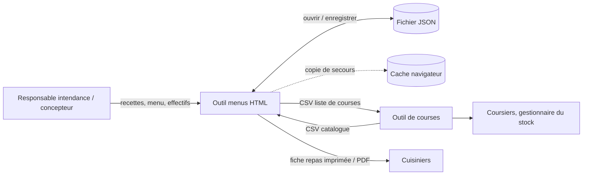
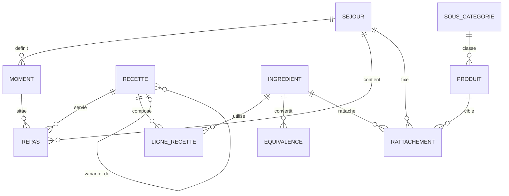
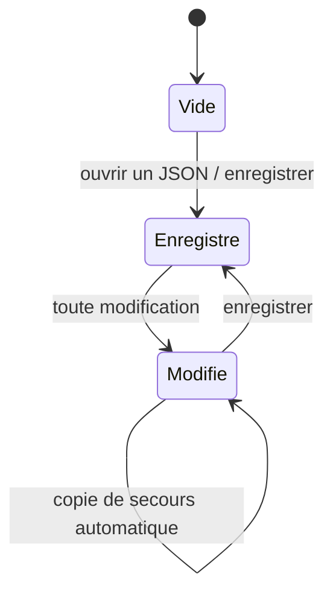
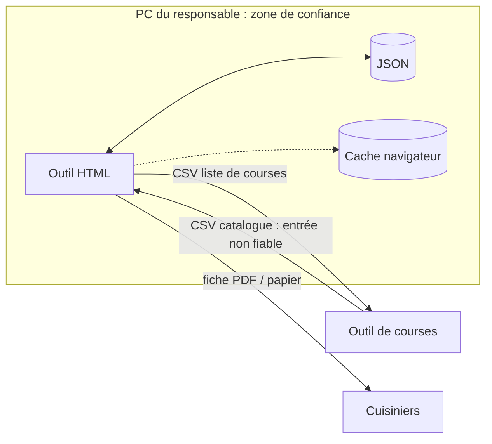

# Solution Design Spec — Menus et courses de séjour

Oct 25, 2026 · @Houssam

## Résumé

La solution est un fichier HTML local unique, sans serveur, organisé en six blocs : bibliothèque, référentiels, catalogue, séjour et menu, calcul et export, persistance. Les données vivent dans un fichier JSON enregistré sur le disque local ; le cache du navigateur sert seulement de copie de secours. L'outil importe le catalogue de l'outil de courses et exporte une liste au format exact de celui-ci, avec une ligne par produit × repas et un total arrondi réparti au prorata. Il n'y a aucune donnée personnelle ; la sécurité porte sur la perte de données, l'intégrité des fichiers importés et l'absence de dépendance réseau (SEC-01 à SEC-08). Trois incréments ; I1 correspond au test d'une soirée.

## Références

- Discovery Brief — Menus et courses de séjour (24 oct. 2026).
- Solution Options Brief — Menus et courses de séjour (25 oct. 2026) : option O4 retenue, plan B O1 (tableur Excel).
- Fichiers d'exemple fournis par le demandeur le 25 oct. 2026 : `Export_liste_produit.csv` (catalogue, 314 produits) et `Export_liste_course.csv` (format attendu par l'outil de courses).

**Contraintes** \[Fait\] : un seul fichier HTML ouvert depuis le disque ; gratuit ; aucun serveur ; construit et maintenu par le demandeur avec l'IA ; un seul utilisateur ; Chrome, Edge et Firefox ; JSON stocké sur le disque local uniquement.

**Périmètre ici** : BE-01 à BE-03, BE-05, BE-06, BE-07 et BE-08 (via l'export), BE-09 (colonne « À commander »), BE-12 ; RM-01, RM-02, RM-03, RM-05, RM-06, RM-07, RM-08 (statut seulement), RM-09, RM-12. **Hors périmètre** (outil de courses) : stock, achats, recalcul des achats restants (BE-10, BE-11, RM-04, RM-10, RM-11).

## Vue d'ensemble

Le responsable intendance est le seul utilisateur ; les autres rôles reçoivent le résultat via l'outil de courses ou la fiche imprimée.

| Bloc | Responsabilité | Étapes TO-BE |
| --- | --- | --- |
| B1 Bibliothèque | Recettes pour 10, lignes de recette, matériel, étiquettes, variantes | T1 |
| B2 Référentiels | Ingrédients, conversions génériques, équivalences par ingrédient | T1, T8 |
| B3 Catalogue | Import du CSV produits, contenance validée, statut frais par sous-catégorie | T5 |
| B4 Séjour et menu | Jours, moments, repas (recette + effectif), rattachements, compteur sur les cartes | T2 à T5 |
| B5 Calcul et export | RM-01 → conversion → arrondi du total → répartition ; alerte ; CSV ; fiche repas | T7, T8, T10, T13 |
| B6 Persistance | Ouvrir et enregistrer le JSON, indicateur « non enregistré », copie de secours | Transverse |

## Modèle de données

Douze entités, toutes non personnelles, contenues dans un seul fichier JSON versionné.

| Entité | Attributs (type, obligatoire\*) | Identifiant | Créé / modifié / supprimé par |
| --- | --- | --- | --- |
| Fichier | version du format\* (nombre), date d'enregistrement\* | — | Outil |
| Paramètres | tolérance d'arrondi\* (%, défaut 0) | unique | Responsable |
| Séjour | nom\* (texte), nombre de jours\* (entier ≥ 1) | id interne | Responsable |
| Moment | séjour\*, nom\* (ex. déjeuner), ordre\* | id interne | Responsable |
| Repas | séjour\*, n° de jour\* (1..n), moment\*, recette\*, effectif (entier ≥ 0) | séjour + jour + moment (unique) | Responsable |
| Recette | nom\*, étiquettes (liste), matériel (liste de textes), origine (recette, si variante) | id interne | Responsable ; suppression bloquée si utilisée |
| Ligne de recette | recette\*, ingrédient\*, quantité pour 10\* (nombre > 0), unité\* | id interne | Responsable |
| Ingrédient | nom\* (unique), dernier produit choisi (code) | id interne | Responsable |
| Équivalence | ingrédient\*, quantité A\* + unité A\*, quantité B\* + unité B\* (ex. 1 pièce = 60 g) | ingrédient + unités | Responsable |
| Produit | 10 colonnes importées ; contenance + unité de contenance ; contenance validée (oui/non) ; présent au dernier import (oui/non) | **Code** (stable) | Import ; contenance par le responsable |
| Sous-catégorie | nom\*, frais (oui/non) | nom | Import ; statut frais par le responsable |
| Rattachement | séjour\*, ingrédient\*, produit\* (code) | séjour + ingrédient (RM-06) | Responsable |

- **Unités** (liste fixe dans le code) : g, kg, ml, cl, l, pièce. Conversions génériques au sein d'une famille (masse, volume), non modifiables.
- **Classification** : aucun attribut personnel. Aucun champ ne doit recevoir le nom d'un participant (minimisation par conception).
- **Conservation** : jusqu'à suppression par le responsable ; supprimer un séjour supprime ses moments, repas et rattachements, sans toucher la bibliothèque.
- **Variantes** : rangées dans la bibliothèque commune, avec un lien vers leur origine.

## Fonctionnalités

Quatorze fonctionnalités, chacune reliée à une étape du TO-BE et à un besoin.

| ID | Le responsable fait → l'outil répond | TO-BE | BE / RM | Incr. |
| --- | --- | --- | --- | --- |
| F-01 | Créer, modifier, dupliquer une recette (lignes, quantité pour 10, unité, matériel) | T1 | BE-01, BE-12 | I1 |
| F-02 | Créer une variante → copie liée à l'origine, dans la bibliothèque | T1 | BE-01, RM-12 | I2 |
| F-03 | Chercher une recette par nom, étiquette ou ingrédient ; étiqueter | T1 | BE-01 | I2 |
| F-04 | Saisir une quantité → conversions connues proposées ; ajouter une équivalence | T1 | BE-06, RM-09 | I1 |
| F-05 | Importer le CSV catalogue → aperçu ajoutés / modifiés / disparus, puis confirmation | T5 | BE-04 | I1 |
| F-06 | Valider ou corriger la contenance proposée d'un produit ; marquer une sous-catégorie « frais » | T5 | BE-04, BE-09, RM-08 | I1 |
| F-07 | Créer un séjour (nom, nombre de jours, moments ordonnés) ; dupliquer un séjour | T2 | BE-02, A-I3 | I1 (dupliquer : I2) |
| F-08 | Placer une recette dans une case jour × moment et saisir l'effectif, avec recopie rapide | T3, T4 | BE-02, BE-03, RM-02 | I1 |
| F-09 | Rattacher chaque ingrédient du séjour à un produit ALM → dernier choix proposé | T5 | BE-05, RM-06, RM-07 | I1 (proposition : I2) |
| F-10 | Voir sur chaque carte de repas le nombre d'ingrédients à compléter | T3 à T5 | Exigence de l'Options Brief | I1 |
| F-11 | Aperçu des besoins par repas, par jour, par produit | T10 | BE-07, BE-08 | I3 |
| F-12 | Exporter le CSV → contrôle préalable, alerte « continuer ou revenir » | T7, T8, T10 | BE-07 à BE-09, RM-01, RM-03, RM-05 | I1 |
| F-13 | Ouvrir, enregistrer le JSON ; indicateur « non enregistré » ; reprise de la copie de secours | Transverse | SEC-01, SEC-02, SEC-05 | I1 |
| F-14 | Imprimer ou enregistrer en PDF la fiche d'un repas à l'effectif | T13 | BE-12 | I3 |

F-10 compte, pour un repas : les ingrédients sans rattachement, ceux dont le produit est introuvable, ceux sans conversion vers la contenance, et un effectif manquant.

## Règles métier dans la solution

La chaîne de calcul de B5 s'applique dans cet ordre : besoin par repas, conversion, total par produit, arrondi, répartition.

| Règle | Où | Comment |
| --- | --- | --- |
| RM-01 | B5, F-12, F-14 | Calcul : besoin = quantité pour 10 × effectif / 10 |
| RM-02 | B4, F-08 | Effectif porté par chaque repas |
| RM-03 | B5 | Somme par produit sur tout le séjour (un export = un achat) ; deux ingrédients rattachés au même produit s'additionnent après conversion |
| RM-05 | B5 | Arrondi sur le total par produit, puis répartition sur les lignes de repas |
| RM-06 | B4, F-09 | Un seul rattachement par séjour + ingrédient (unicité imposée) |
| RM-07 | B2, F-09 | Choisir un produit met à jour le « dernier produit » de l'ingrédient ; proposé à chaque nouveau séjour, modifiable |
| RM-08 | B3, F-12 | « À commander » = « Frais » si la sous-catégorie du produit est frais, sinon « Gros achat » |
| RM-09 | B2, F-04, B5 | Conversion vers l'unité de contenance du produit (voir ci-dessous) |
| RM-12 | B1, F-02 | Une variante est une copie ; la modifier ne touche jamais l'origine |

**RM-01, besoin par repas.** Pâtes 1 kg pour 10, effectif 23 → 2,3 kg. Effectif 0 → 0, la ligne est omise. Effectif vide → compté dans F-10 et listé dans l'alerte ; ce repas n'est pas exporté. Une valeur négative ou non numérique est refusée à la saisie. Modifier une recette d'origine modifie les repas qui l'utilisent (ADR-06).

**RM-09, conversion.**

1. Même famille (masse ou volume) : conversion générique (1 kg = 1000 g ; 1 l = 100 cl = 1000 ml).
2. Sinon, équivalence de l'ingrédient (ex. œuf : 1 pièce = 60 g), dans un sens ou dans l'autre.
3. Sinon, « sans conversion » : compté dans F-10, listé dans l'alerte. Si l'utilisateur continue, la ligne est exportée avec la quantité exacte dans l'unité de la recette, la mention « À vérifier » dans « À commander », et elle est exclue de l'arrondi.

**Contenance d'un produit.** L'outil propose une contenance tirée de la colonne `Unité` : « 500g » → 500 g ; « 1,5L » → 1,5 l ; « 10x20cl » → 200 cl ; « caisse 8 kg » → 8 kg ; « ±1kg » → 1 kg ; « 10pc » → 10 pièces. Les valeurs illisibles (« unité », « rouleau », « kg » seul, vide) ne proposent rien. **Aucune contenance n'est utilisée tant qu'elle n'a pas été validée d'un clic** (ADR-04). Contenance non validée → comptée dans F-10. Un nouvel import ne change pas une contenance validée ; si `Unité` a changé, la validation est retirée et le produit est signalé.

**RM-05, arrondi du total.** Soit Q le total converti d'un produit et C sa contenance. N = Q / C. Le total arrondi T vaut ⌊N⌋ si (N − ⌊N⌋) × C ≤ tolérance × Q, sinon ⌈N⌉. Si N est entier, T = N. Exemples : Q = 2,05 kg, C = 1 kg → tolérance 0 % : T = 3 ; tolérance 5 % : 0,05 ≤ 0,1025, donc T = 2.

**Répartition sur les lignes (plus fort reste).** Chaque ligne de repas i a un besoin exact qi. Part i = T × qi / Q. Chaque ligne reçoit ⌊part⌋ ; les unités restantes vont, une par une, aux lignes dont la partie décimale de la part est la plus grande (à égalité : l'ordre chronologique, jour puis moment). La somme des lignes vaut toujours T, et chaque ligne reste au plus à 1 de sa part exacte : 1 et 9 donnent 1 et 9, jamais 5 et 5. Une ligne peut recevoir 0 ; elle est exportée avec 0 (ADR-05).

**Données manquantes ou incohérentes.**

- Ingrédient sans rattachement → F-10, alerte ; non exporté si l'utilisateur continue (aucun code produit à exporter).
- Produit absent du dernier import → rattachement « produit introuvable », F-10, alerte ; exporté avec les dernières valeurs connues si l'utilisateur continue.
- Recette utilisée dans un séjour → suppression refusée, avec la liste des séjours.
- Moment supprimé alors qu'il porte des repas → confirmation, puis suppression des repas concernés.
- Nombre de jours réduit → confirmation listant les repas des jours supprimés.

## États et cycle de vie

Aucun objet n'a de statut à faire évoluer : les achats « réalisés » vivent dans l'outil de courses. La complétude d'un repas (F-10) et l'état « non enregistré » du fichier (F-13) sont calculés, jamais stockés.

Le fichier lui-même suit trois états à rendre visibles :

## Rôles et droits

Un seul rôle utilise l'outil ; l'accès se confond avec l'accès au PC et au fichier JSON, sans compte ni mot de passe.

| Rôle | Recettes, référentiels | Catalogue | Séjour, menu, rattachements | Export CSV | Fiche repas |
| --- | --- | --- | --- | --- | --- |
| Responsable intendance (concepteur) | Voir, créer, modifier, supprimer | Importer, compléter | Voir, créer, modifier, supprimer | Exporter | Imprimer |
| Cuisiniers | — | — | — | — | Reçoivent la fiche imprimée ou en PDF |
| Coursiers, gestionnaire du stock | — | — | — | Reçoivent la liste via l'outil de courses | — |

**Mode d'accès** : fichier HTML et fichier JSON sur le disque local du responsable ; aucun partage, aucun lien public. Le moindre privilège est respecté : les autres rôles ne reçoivent que la sortie qui les concerne. Le fichier JSON ne contenant aucune donnée personnelle, aucun chiffrement n'est requis \[Hypothèse : les prix fournisseurs ne sont pas confidentiels\].

## Flux de données et contrat d'interface

Deux fichiers franchissent la frontière du PC : le catalogue qui entre, traité comme non fiable, et la liste de courses qui sort.

**Import catalogue** (entrée, à la demande, F-05)

- Fichier : UTF-8, BOM accepté, séparateur `;`, fins de ligne CRLF ou LF, virgule décimale, champs éventuellement entre guillemets.
- Colonnes attendues par leur nom : `Code;Nom;Marque;Sous-catégorie;Unité;Prix unitaire (EUR);Magasin;Fiche produit;Statut;Actif`. Colonne manquante → import refusé. Colonne supplémentaire → ignorée, signalée.
- Identifiant commun : `Code`, unique et stable \[Fait, confirmé par le demandeur\]. Un doublon de code dans le fichier → import refusé.
- Rattachables : codes commençant par `ALM-` et `Actif` = Oui. `Statut` « En attente de validation » : rattachable, avec un badge.
- Mise à jour : ajout des nouveaux codes, mise à jour des codes connus, marquage « absent » des codes disparus (jamais supprimés). Aperçu chiffré puis confirmation.

**Export liste de courses** (sortie, à la demande, F-12)

- Fichier : UTF-8 sans BOM, `;`, CRLF, virgule décimale, nom proposé `liste-courses_<séjour>_<AAAA-MM-JJ>.csv`.
- Colonnes, dans cet ordre : `Code;Article;Marque;Magasin;Quantité;Unité;Prix unitaire (EUR);Total ligne (EUR);Destination;Activité;À commander;Fiche produit`.
- Une ligne par produit × repas, triée par jour, ordre des moments, puis magasin et article.

| Colonne export | Source |
| --- | --- |
| Code, Marque, Magasin, Unité, Prix unitaire, Fiche produit | Produit rattaché (valeurs du dernier import) |
| Article | `Nom` du produit |
| Quantité | Part répartie du total arrondi (RM-05) ; quantité exacte si « sans conversion » |
| Total ligne (EUR) | Quantité × Prix unitaire, 2 décimales |
| Destination | Nom du moment (ex. Déjeuner) |
| Activité | Jour : J1, J2… |
| À commander | « Frais », « Gros achat » ou « À vérifier » |

- **Responsabilité** : le responsable lance l'export et l'importe dans l'outil de courses.
- **Changement après export** : un nouvel export complet remplace le précédent ; le recalcul des achats restants se fait dans l'outil de courses (RM-10).
- **Dépendance** \[Fait\] : l'outil de courses doit lire `Activité` comme jour et `Destination` comme moment ; le demandeur l'adapte de son côté (ADR-03).

## Sécurité et vie privée

Sans donnée personnelle, l'analyse porte sur la perte de données et l'intégrité des fichiers échangés ; huit exigences en découlent.

| ID | Menace retenue | Exigence vérifiable | Test |
| --- | --- | --- | --- |
| SEC-01 | Indisponibilité : modifications perdues | Le JSON est la seule source de vérité ; indicateur visible « non enregistré » ; avertissement du navigateur à la fermeture s'il reste des modifications | T-SEC-01 |
| SEC-02 | Indisponibilité : fermeture brutale | Copie automatique du dernier état dans le cache du navigateur à chaque modification ; à la réouverture, proposition de reprise avec sa date, jamais appliquée sans confirmation | T-SEC-02 |
| SEC-03 | Indisponibilité : écrasement d'un bon fichier | À l'enregistrement, nom daté proposé (`menus_AAAA-MM-JJ_HHmm.json`) pour garder des versions successives | T-SEC-03 |
| SEC-04 | Altération / injection : texte piégé dans un CSV ou JSON | Tout texte importé est affiché comme texte, jamais interprété comme du HTML ou du script ; `Fiche produit` n'est cliquable qu'en `http(s)://`, ouverte dans un nouvel onglet isolé | T-SEC-04 |
| SEC-05 | Intégrité : JSON corrompu ou d'un autre format | Validation du format et de la version avant chargement ; en cas d'échec, refus complet avec message, l'état courant reste intact ; migration explicite des anciennes versions | T-SEC-05 |
| SEC-06 | Intégrité : import catalogue erroné | Contrôle des colonnes et des doublons ; aperçu ajoutés / modifiés / absents à confirmer ; aucun produit supprimé | T-SEC-06 |
| SEC-07 | Injection de formules dans le CSV ouvert dans un tableur | Un champ texte commençant par `=`, `+`, `@` ou une tabulation est préfixé d'une apostrophe à l'export ; les nombres ne sont jamais modifiés | T-SEC-07 |
| SEC-08 | Chaîne d'approvisionnement et fuite réseau | Aucune ressource chargée depuis Internet ; toute bibliothèque est intégrée au fichier avec sa version et sa licence ; une politique de sécurité du contenu interdit toute connexion sortante | T-SEC-08 |

**Menaces écartées** : usurpation et élévation de privilèges (un seul utilisateur, aucun compte) ; répudiation (pas d'enjeu de preuve) ; divulgation (aucune donnée personnelle, prix non confidentiels \[Hypothèse\]).

**Vie privée (LINDDUN) et RGPD** : non applicables tant qu'aucune donnée personnelle n'entre dans l'outil. Les effectifs sont des nombres anonymes. Aucun champ ne demande le nom d'un participant ni d'un auteur. Si un futur besoin introduit des noms (ex. effectifs repris d'un outil de présence avec des personnes), une nouvelle analyse sera nécessaire.

**Mineurs** : non applicable, aucune donnée sur les participants.

**Continuité** : l'outil sert avant le séjour. Pendant celui-ci, l'outil de courses prend le relais. Si le PC est indisponible, le menu ne peut plus être modifié, mais les listes déjà exportées restent utilisables.

**Risques résiduels acceptés par le demandeur** (25 oct. 2026)

| ID | Risque | Mesure qui le réduit |
| --- | --- | --- |
| R1 | Perte des modifications si rien n'est enregistré et que le cache est vidé | SEC-01, SEC-02 |
| R3 | Une ligne de repas à très faible besoin reçoit 0 à la répartition | Exportée avec 0, total juste |
| R4 | Perte du PC : JSON sur le disque local seulement | SEC-03 (versions datées) ; copie manuelle conseillée |

R2 (contenance mal déduite) n'est **pas** accepté : il est éliminé par la validation obligatoire (ADR-04).

## Exigences non fonctionnelles

| ID | Exigence | Mesure |
| --- | --- | --- |
| ENF-01 | Volumes | 500 recettes, 2 000 lignes de recette, 400 produits, séjour de 21 jours × 6 moments, sans dégradation |
| ENF-02 | Réactivité | Compteurs F-10 et aperçu recalculés en moins de 1 s après une modification, aux volumes ENF-01 |
| ENF-03 | Hors connexion | Fonctionne depuis le disque (`file://`), sans réseau |
| ENF-04 | Navigateurs | Versions récentes de Chrome, Edge et Firefox. Enregistrement direct dans le fichier sous Chrome/Edge ; téléchargement sous Firefox ([web.dev](https://web.dev/articles/files/save-a-file?hl=es), 29 juil. 2026) |
| ENF-05 | Portabilité | JSON lisible, clés en clair, champ de version ; structure tabulaire transposable dans Excel (plan B) |
| ENF-06 | Maintenabilité | Code commenté par bloc (B1 à B6) ; page « À propos » avec la version de l'outil, la version du format JSON et la liste des bibliothèques intégrées |
| ENF-07 | Impression | Fiche repas lisible sur une page A4 portrait pour une recette de 15 lignes |

## Incréments et user stories

I1 est le plus petit parcours complet : du catalogue importé à une liste de courses acceptée par l'outil de courses. Il sert aussi de test d'une soirée.

| Incrément | Contenu | Critère de succès visé |
| --- | --- | --- |
| I1 Parcours complet | F-01, F-04, F-05, F-06, F-07 (créer), F-08, F-09 (sans proposition), F-10, F-12, F-13 ; SEC-01 à SEC-08 ; tests des capacités \[Non vérifié\] | Plus de calcul manuel |
| I2 Réutilisation | F-02, F-03, F-07 (dupliquer), F-09 (dernier produit proposé), suggestions de matériel | Préparation plus rapide |
| I3 Confort et terrain | F-11, F-14, tolérance paramétrable, page À propos | Autonomie des rôles, ni manque ni gaspillage |

### I1 — Parcours complet

**US-01 Importer le catalogue** — En tant que responsable, je veux importer le CSV produits de mon outil de courses, afin de rattacher des ingrédients à de vrais produits. (F-05, BE-04, SEC-06)

- Étant donné le fichier `Export_liste_produit.csv` fourni, quand je l'importe, alors l'aperçu annonce 314 produits ajoutés, dont 251 rattachables (ALM), et rien n'est enregistré avant ma confirmation.
- Étant donné un catalogue déjà importé, quand j'importe un fichier où un code a disparu, alors ce produit est marqué « absent » et ses rattachements sont comptés dans F-10.
- Étant donné un fichier sans la colonne `Code`, quand je l'importe, alors l'import est refusé et le message nomme la colonne manquante.
- Contrôles : BOM accepté ; virgule décimale lue (1,99 → 1.99) ; codes en double refusés.

**US-02 Valider les contenances** — En tant que responsable, je veux valider la contenance proposée pour chaque produit, afin que l'arrondi soit juste. (F-06, RM-05, ADR-04)

- Étant donné un produit d'unité « 1,5L », quand j'ouvre sa fiche, alors l'outil propose 1,5 l, non validée, jusqu'à mon clic.
- Étant donné un produit d'unité « rouleau », alors aucune contenance n'est proposée et je peux en saisir une.
- Étant donné une contenance validée, quand un nouvel import change `Unité`, alors la validation est retirée et le produit est signalé.

**US-03 Saisir une recette** — En tant que concepteur, je veux saisir une recette pour 10 avec son matériel, afin de la réutiliser. (F-01, F-04, BE-01, BE-06, BE-12, RM-09)

- Étant donné l'ingrédient « œuf » avec l'équivalence 1 pièce = 60 g, quand je saisis 12 pièces, alors l'outil affiche « ≈ 720 g ».
- Étant donné une quantité négative ou nulle, quand j'enregistre la ligne, alors la saisie est refusée.
- Contrôles : nom de recette obligatoire ; unité choisie dans la liste fixe ; nom d'ingrédient unique (sans tenir compte des majuscules).

**US-04 Composer le menu** — En tant que concepteur, je veux créer un séjour et placer une recette et un effectif dans chaque case, afin de décrire tous les repas. (F-07, F-08, BE-02, BE-03, RM-02)

- Étant donné un séjour de 3 jours et 4 moments, alors la grille affiche 12 cases, J1 à J3.
- Étant donné une case remplie, quand j'y place une autre recette, alors la première est remplacée après confirmation (une recette par repas).
- Étant donné un effectif saisi, quand j'utilise la recopie rapide, alors il est copié dans les cases choisies.

**US-05 Rattacher les ingrédients** — En tant que responsable, je veux rattacher chaque ingrédient du séjour à un produit, afin d'obtenir une liste achetable. (F-09, BE-05, RM-06)

- Étant donné l'ingrédient « pâtes » utilisé dans 3 repas, quand je le rattache à un produit, alors les 3 repas utilisent ce produit (un seul rattachement par séjour).
- Contrôle : seuls les produits ALM actifs sont proposés ; badge pour « En attente de validation ».

**US-06 Voir ce qui manque** — En tant que responsable, je veux voir sur chaque carte de repas un chiffre indiquant ce qui reste à compléter, afin de corriger avant l'export. (F-10)

- Étant donné un repas avec 2 ingrédients non rattachés et 1 sans conversion, alors sa carte affiche 3.
- Étant donné un repas complet, alors aucun chiffre n'est affiché.

**US-07 Exporter la liste de courses** — En tant que responsable, je veux exporter la liste au format de mon outil de courses, afin de l'importer sans retouche. (F-12, BE-07 à BE-09, RM-01, RM-03, RM-05, RM-08, SEC-07)

- Étant donné un menu complet, quand j'exporte, alors le fichier a les 12 colonnes dans l'ordre du contrat et s'importe dans l'outil de courses.
- Étant donné des éléments incomplets, quand j'exporte, alors l'alerte les liste et me propose « Continuer » ou « Revenir ».
- Étant donné les cas TR-01 à TR-08, alors les quantités exportées sont celles du jeu de tests.

**US-08 Enregistrer et rouvrir** — En tant que responsable, je veux enregistrer mon travail dans un fichier et le rouvrir, afin de ne rien perdre. (F-13, SEC-01 à SEC-03, SEC-05)

- Étant donné des modifications non enregistrées, alors l'indicateur « non enregistré » est visible et la fermeture de l'onglet déclenche un avertissement.
- Étant donné un onglet fermé sans enregistrer, quand je rouvre l'outil, alors la reprise de la copie de secours m'est proposée avec sa date.
- Étant donné un JSON modifié à la main et invalide, quand je l'ouvre, alors il est refusé et mes données actuelles restent intactes.
- Étant donné Chrome puis Firefox, alors l'enregistrement fonctionne dans les deux (direct ou téléchargement) et le fichier se rouvre à l'identique.

### I2 — Réutilisation

- **US-09 Variante** (F-02, RM-12) : étant donné une recette, quand je crée une variante et modifie une quantité, alors l'origine est inchangée et la variante affiche son origine.
- **US-10 Retrouver une recette** (F-03, BE-01) : étant donné l'étiquette « petit-déjeuner », quand je filtre, alors seules les recettes qui la portent s'affichent ; la recherche par ingrédient trouve les recettes qui le contiennent.
- **US-11 Dupliquer un séjour** (F-07, A-I3) : étant donné un séjour passé, quand je le duplique, alors moments, repas, effectifs et rattachements sont copiés dans un nouveau séjour indépendant.
- **US-12 Dernier produit proposé** (F-09, RM-07) : étant donné « pâtes » rattaché à ALM-0xx dans un séjour, quand l'ingrédient apparaît dans un nouveau séjour, alors ALM-0xx est proposé, modifiable ; un produit absent n'est pas proposé.

### I3 — Confort et terrain

- **US-13 Aperçu des besoins** (F-11, BE-08) : étant donné un menu, alors je vois les besoins par repas, par jour et par produit, avec les mêmes chiffres que l'export.
- **US-14 Fiche repas** (F-14, BE-12, ENF-07) : étant donné un repas à 23 personnes, quand j'imprime sa fiche, alors elle montre les quantités mises à l'échelle et le matériel, sur une page A4.
- **US-15 Tolérance** (RM-05) : étant donné une tolérance de 5 %, alors TR-05 donne 2 et non 3.
- **US-16 À propos** (ENF-06) : la page affiche la version de l'outil, celle du format JSON et les bibliothèques intégrées.

## Jeu de tests de référence

Chaque calcul a des cas chiffrés, à rejouer à chaque modification du code. Tolérance de 0 % sauf mention contraire.

**Calculs (RM-01, RM-03, RM-05, RM-09)**

| ID | Données | Résultat attendu |
| --- | --- | --- |
| TR-01 | Pâtes 1 kg pour 10, effectif 23 | Besoin 2,3 kg |
| TR-02 | Même recette, effectif 0 | Aucune ligne pour ce repas |
| TR-03 | 250 g pour 10, effectif 10, contenance 1 kg | 0,25 kg → Quantité 1 |
| TR-04 | Oignon 3 pièces pour 10, équivalence 1 pièce = 150 g, effectif 20, contenance 1 kg | 6 pièces = 900 g = 0,9 kg → 1 |
| TR-05 | Total 2,05 kg, contenance 1 kg | Tolérance 0 % → 3 ; tolérance 5 % → 2 |
| TR-06 | Total 3 kg, contenance 1 kg | 3 (pas 4) |
| TR-07 | J1 Déjeuner 2,3 kg ; J2 Dîner 1,4 kg ; contenance 1 kg | Total 3,7 → 4 ; lignes 2 et 2 |
| TR-08 | J1 0,8 kg ; J2 8,7 kg ; contenance 1 kg | Total 9,5 → 10 ; lignes 1 et 9 |
| TR-09 | Sel : J1 0,02 kg ; J2 0,02 kg ; J3 0,5 kg ; contenance 1 kg | Total 1 ; lignes 0, 0, 1 (lignes à 0 exportées) |
| TR-10 | J1 0,5 kg ; J2 0,5 kg ; contenance 1 kg | Total 1 ; égalité → J1 = 1, J2 = 0 |
| TR-11 | Même repas : « oignon » 200 g et « oignon émincé » 300 g, même produit 1 kg | Une seule ligne, 0,5 kg → 1 |
| TR-12 | « Citron » 4 pièces, produit au kg, sans équivalence ; l'utilisateur continue | Ligne exportée : Quantité 4, À commander = « À vérifier », hors arrondi |
| TR-13 | Quantité 8, prix 1,99 | Total ligne 15,92 |
| TR-14 | Sous-catégories « Fruits & légumes », « Féculents (pâtes, riz, farine) », vide | Frais ; Gros achat ; Gros achat |

**Contenance proposée depuis `Unité`**

| `Unité` | Proposition |
| --- | --- |
| 500g | 500 g |
| 1,5L | 1,5 l |
| 10x20cl | 200 cl |
| caisse 8 kg | 8 kg |
| ±1kg | 1 kg |
| 10pc | 10 pièces |
| pqt de 100 | 100 pièces |
| unité / rouleau / kg / vide | Aucune proposition |

**Sécurité**

| ID | Action | Résultat attendu |
| --- | --- | --- |
| T-SEC-01 | Modifier puis fermer l'onglet | Avertissement du navigateur ; indicateur visible avant fermeture |
| T-SEC-02 | Modifier, forcer la fermeture du navigateur, rouvrir | Reprise proposée avec sa date ; refuser laisse l'outil vide |
| T-SEC-03 | Enregistrer deux fois | Deux noms datés proposés ; l'ancien fichier n'est pas écrasé sans action explicite |
| T-SEC-04 | Importer un produit nommé `` et une fiche `javascript:alert(1)` | Le nom s'affiche en texte brut ; le lien n'est pas cliquable |
| T-SEC-05 | Ouvrir un JSON tronqué, puis un JSON de version inconnue | Refus avec message ; données courantes intactes |
| T-SEC-06 | Importer un CSV avec un code en double | Import refusé, code nommé |
| T-SEC-07 | Produit nommé `=HYPERLINK("http://x")` puis export | Champ exporté `'=HYPERLINK("http://x")` ; prix et quantités inchangés |
| T-SEC-08 | Ouvrir l'outil réseau coupé ; contrôler la console réseau | Tout fonctionne ; aucune requête sortante |

## Décisions (ADR)

Toutes ont été prises par le demandeur le 25 oct. 2026, statut : acceptée.

| ADR | Contexte | Décision | Alternatives écartées | Conséquences |
| --- | --- | --- | --- | --- |
| ADR-01 | Où vivent les données | Fichier JSON = source de vérité ; cache du navigateur = copie de secours ; disque local seul | Cache seul ; dossier OneDrive | Risques R1 et R4 acceptés ; noms datés à l'enregistrement |
| ADR-02 | Conversions d'unités | Génériques (masse, volume) dans le code + équivalences par ingrédient | Tout par ingrédient ; recette dans l'unité du produit | Saisie libre de l'unité ; signalement « sans conversion » |
| ADR-03 | Export vers l'outil de courses | Un seul CSV au format de l'outil de courses, une ligne par produit × repas, `Activité` = jour, `Destination` = moment, `À commander` = Frais / Gros achat / À vérifier | Deux fichiers (liste + détail) ; colonnes ajoutées | Colonnes détournées ; l'outil de courses doit être adapté par le demandeur |
| ADR-04 | Contenance des produits absente du catalogue | Contenance proposée depuis `Unité`, saisie et validée ici, conservée entre imports ; validation obligatoire | Colonne ajoutée dans l'outil de courses ; pas d'arrondi | Travail de validation initial (environ 251 produits ALM) |
| ADR-05 | Arrondi et lignes par repas | Arrondi sur le total par produit (tolérance par défaut 0 %), réparti au plus fort reste ; lignes à 0 exportées | Arrondi par ligne ; quantité décimale | Total juste ; une ligne peut afficher 0 |
| ADR-06 | Modifier une recette d'origine | Les repas planifiés suivent la recette ; pour figer, créer une variante | Copie figée à la planification | Un ancien séjour change si on modifie la recette qu'il utilise |
| ADR-07 | Variantes | Rangées dans la bibliothèque commune, avec un lien vers l'origine | Variante liée à un séjour | La bibliothèque grossit ; F-03 doit permettre de filtrer |
| ADR-08 | Statut frais | Porté par la sous-catégorie ; frais par défaut : Fruits & légumes, Frais (crèmerie, fromages), Boulangerie, Boucherie | Par produit ; dans l'outil de courses | Produits sans sous-catégorie (59) = Gros achat |
| ADR-09 | Produits rattachables | Codes ALM actifs seulement ; « En attente de validation » autorisés avec badge | CMB, HYG inclus | Le matériel jetable reste hors calcul |
| ADR-10 | Composition d'un repas | Une recette par repas ; jours notés J1, J2… | Plusieurs plats ; dates | Un menu sans date est réutilisable |

## Matrice de traçabilité

Le contrôle de complétude passe : chaque besoin, règle et exigence de sécurité mène à une story et à un test.

| Élément | Fonctionnalité | Story | Test |
| --- | --- | --- | --- |
| BE-01 | F-01, F-02, F-03 | US-03, US-09, US-10 | US-09, US-10 |
| BE-02 | F-07, F-08 | US-04, US-11 | US-04 |
| BE-03 | F-08 | US-04 | TR-01, TR-02 |
| BE-04 | F-05, F-06 | US-01, US-02 | US-01, table des contenances |
| BE-05 | F-09 | US-05, US-12 | US-05, US-12 |
| BE-06 | F-04 | US-03 | TR-04 |
| BE-07 | F-12 | US-07 | TR-03 à TR-13 |
| BE-08 | F-11, F-12 | US-07, US-13 | US-13 |
| BE-09 | F-06, F-12 | US-07 | TR-14 |
| BE-12 | F-01, F-14 | US-03, US-14 | US-14 |
| RM-01 | F-12 | US-07 | TR-01, TR-02 |
| RM-02 | F-08 | US-04 | TR-07 |
| RM-03 | F-12 | US-07 | TR-07, TR-11 |
| RM-05 | F-12 | US-07, US-15 | TR-05 à TR-10 |
| RM-06 | F-09 | US-05 | US-05 |
| RM-07 | F-09 | US-12 | US-12 |
| RM-08 | F-06, F-12 | US-07 | TR-14 |
| RM-09 | F-04 | US-03 | TR-03, TR-04, TR-12 |
| RM-12 | F-02 | US-09 | US-09 |
| Compteur sur les cartes | F-10 | US-06 | US-06 |
| Alerte à l'export | F-12 | US-07 | US-07, TR-12 |
| SEC-01 à SEC-03 | F-13 | US-08 | T-SEC-01 à 03 |
| SEC-04 | F-05 | US-01 | T-SEC-04 |
| SEC-05 | F-13 | US-08 | T-SEC-05 |
| SEC-06 | F-05 | US-01 | T-SEC-06 |
| SEC-07 | F-12 | US-07 | T-SEC-07 |
| SEC-08 | Toutes | I1 (configuration) | T-SEC-08 |

**Critères de succès, en recette**

| Critère | Comment l'observer |
| --- | --- |
| Plus de calcul manuel | L'export d'un vrai séjour s'importe dans l'outil de courses sans retouche (US-07) |
| Ni manque ni gaspillage | TR-05 à TR-10 justes ; après le séjour, restes et manques relevés dans l'outil de courses |
| Préparation plus rapide | Temps de préparation du premier séjour mesuré et comparé à celui du tableur (référence à relever avant) |
| Autonomie des rôles | Cuisiniers servis par la fiche repas (US-14) ; coursiers et stock par l'outil de courses |

Hors périmètre, renvoyés à l'outil de courses : BE-10, BE-11, RM-04, RM-10, RM-11. Aucune fonctionnalité, story ou attribut sans besoin associé.

## Glossaire

Termes du Discovery Brief, repris tels quels, complétés des termes introduits par la conception (en gras).

| Terme | Définition |
| --- | --- |
| Séjour | Période avec des jours (J1, J2…) et des moments de repas, pour laquelle on prépare un menu |
| Moment | Créneau de repas dans une journée (ex. déjeuner), défini par séjour |
| Repas | Un jour × un moment, avec une recette et un effectif |
| Recette (fiche) | Plat défini par ses ingrédients, leurs quantités pour 10 personnes et le matériel |
| Variante | Copie adaptée d'une recette, rangée dans la bibliothèque, sans toucher l'original |
| Ingrédient | Élément d'une recette, exprimé dans une unité de recette |
| Produit | Article du catalogue de l'outil de courses, identifié par son Code |
| Conditionnement | Quantité vendue par unité de produit (ex. paquet de 1 kg) |
| **Contenance** | Valeur chiffrée du conditionnement (ex. 1 kg), proposée depuis `Unité` et validée par le responsable |
| Conversion | Correspondance entre unités ; **générique** au sein d'une famille (g/kg, ml/l) |
| **Équivalence** | Conversion propre à un ingrédient entre familles (ex. 1 œuf = 60 g) |
| **Rattachement** | Lien entre un ingrédient et un produit, pour un séjour |
| Effectif | Nombre de personnes à nourrir pour un repas |
| Gros achat | Achat de départ regroupant les produits non frais |
| Achat frais | Achat en cours de séjour des produits dont la sous-catégorie est marquée frais |
| **Total arrondi** | Nombre de produits à acheter sur le séjour, après arrondi au conditionnement |
| **Répartition** | Distribution du total arrondi sur les lignes de repas, au plus fort reste |
| **Compteur** | Chiffre sur la carte d'un repas : éléments à compléter avant l'export |
| **Copie de secours** | Dernier état gardé dans le navigateur, proposable à la réouverture |
| **Outil de courses** | Outil du demandeur qui gère catalogue, achats et stock |

## Questions ouvertes

Aucune ne bloque I1 ; la première doit être réglée avant l'utilisation réelle.

| Question | Impact | Qui peut répondre |
| --- | --- | --- |
| L'outil de courses accepte-t-il à l'import plusieurs lignes du même code (une par repas) et des quantités à 0 ? | ADR-03, ADR-05 | Demandeur (test en I1) |
| L'outil de courses lit-il `Activité` comme jour et `Destination` comme moment ? | ADR-03 | Demandeur (adaptation de l'outil de courses) |
| Quelle tolérance d'arrondi définitive ? | RM-05 | Demandeur |
| Faut-il un délai ou une vague pour les achats frais (ex. J−1) ? | RM-08 ; aujourd'hui seul le jour du repas est exporté | Demandeur, coursiers |
| Quelles étiquettes de classement proposer d'office ? | F-03 | Concepteurs |
| Les prix fournisseurs sont-ils confidentiels ? | Hypothèse de non-divulgation | Demandeur |
| La fiche repas doit-elle comporter des étapes de préparation ? | F-14, modèle Recette | Cuisiniers |

## Transmission à l'UX/UI Designer

Un seul utilisateur, sur ordinateur ; l'essentiel de l'expérience est la composition du menu et la correction de ce qui manque avant l'export.

**Responsable intendance / concepteur** (ordinateur, Chrome, Edge ou Firefox)

- **Tâches** : importer le catalogue, valider les contenances, saisir recettes et équivalences, créer un séjour, composer la grille, saisir les effectifs, rattacher les ingrédients, exporter, enregistrer, imprimer les fiches.
- **Voit** : bibliothèque filtrable ; grille jours (J1…) × moments avec, sur chaque carte, la recette, l'effectif et le compteur ; liste des ingrédients du séjour avec leur produit ; aperçu des besoins (I3) ; état du fichier.
- **Actions fréquentes à rendre rapides** : placer une recette dans une case, recopier un effectif sur plusieurs cases, rattacher un ingrédient depuis une recherche dans le catalogue.

**Cuisiniers** : reçoivent la fiche repas imprimée (A4 portrait) ; ils n'utilisent pas l'outil.

**États et alertes à rendre visibles**

- État du fichier : vide, enregistré (nom + heure), non enregistré.
- Compteur sur chaque carte de repas, avec le détail au survol ou au clic : non rattaché, produit introuvable, sans conversion, contenance non validée, effectif manquant.
- Contenance proposée et non validée, distincte d'une contenance validée.
- Badge « En attente de validation » sur un produit.
- Alerte d'export : liste groupée des manques, boutons « Revenir » (par défaut) et « Continuer ».
- Aperçu d'import catalogue : ajoutés, modifiés, absents, puis confirmation.
- Proposition de reprise de la copie de secours, avec sa date.
- Conversion proposée pendant la saisie (ex. « 12 pièces ≈ 720 g »).

**Contraintes d'affichage** : aucun texte importé rendu comme du HTML (SEC-04) ; aucune ressource externe (polices, icônes) chargée depuis Internet (SEC-08).

## Transmission au Solution Builder

Construire I1 en premier et commencer par tester les capacités du navigateur dont tout dépend.

**Capacités à tester d'abord** \[Non vérifié pour un fichier ouvert en `file://`\]

1. Enregistrement direct d'un fichier sous Chrome et Edge, repli par téléchargement sous Firefox, depuis une page ouverte en `file://`.
2. Cache navigateur (stockage local) disponible et conservé entre deux ouvertures du même fichier HTML en `file://`, dans les trois navigateurs.
3. Politique de sécurité du contenu déclarée dans la page, effective en `file://` (aucune requête sortante possible).
4. Import du CSV exporté dans l'outil de courses (plusieurs lignes du même code, quantités à 0).

Si le point 2 échoue, SEC-02 devient un rappel d'enregistrement plus insistant ; signaler l'écart avant de continuer.

**Ordre** : I1 (US-01 à US-08), puis I2 (US-09 à US-12), puis I3 (US-13 à US-16).

**À respecter** : ADR-01 à ADR-10 ; contrat d'interface (section Flux) ; SEC-01 à SEC-08.

**Jeu de tests** : TR-01 à TR-14, table des contenances, T-SEC-01 à T-SEC-08. Les intégrer à une page de tests interne au fichier, exécutable d'un clic, pour les rejouer à chaque évolution faite avec l'IA.

**Maintenance et documentation**

- Un seul fichier HTML, code organisé et commenté par bloc (B1 à B6).
- Format JSON versionné et décrit dans la page « À propos » ; toute évolution du format livre sa migration.
- Bibliothèques tierces : éviter ; si nécessaire, version intégrée et notée.
- Fichier d'exemple fourni (`Export_liste_produit.csv`) utilisé comme donnée de test d'import.

## Check-list sécurité avant mise en service

- [ ] SEC-01 : indicateur « non enregistré » visible ; avertissement à la fermeture (T-SEC-01)
- [ ] SEC-02 : copie de secours proposée à la réouverture, jamais appliquée d'office (T-SEC-02)
- [ ] SEC-03 : nom daté proposé à chaque enregistrement (T-SEC-03)
- [ ] SEC-04 : aucun texte importé interprété ; liens limités à http(s) (T-SEC-04)
- [ ] SEC-05 : JSON invalide refusé sans perte (T-SEC-05)
- [ ] SEC-06 : contrôle des colonnes et doublons, aperçu d'import (T-SEC-06)
- [ ] SEC-07 : neutralisation des formules à l'export (T-SEC-07)
- [ ] SEC-08 : politique de sécurité du contenu présente ; aucune ressource externe ; liste des bibliothèques intégrées à jour (T-SEC-08)
- [ ] Aucun champ ne collecte de nom de participant
- [ ] Une copie du fichier JSON existe ailleurs que sur le PC avant chaque séjour (mesure manuelle liée à R4)
- [ ] Jeu de tests TR-01 à TR-14 au vert

## Sources

- [web.dev — Enregistrer un fichier](https://web.dev/articles/files/save-a-file?hl=es) : enregistrement direct sous Chrome/Edge, téléchargement ailleurs (mis à jour le 29 juil. 2026, consulté le 25 oct. 2026)
- [web.dev — Persistent storage](https://web.dev/articles/persistent-storage) : effacement possible du stockage navigateur (mis à jour le 12 mai 2020, consulté le 25 oct. 2026)
- [gram — Shopping list aggregation](https://abiwab.codeberg.page/gram/explanation/shopping-list-aggregation) : agrégation multi-unités (consulté le 25 oct. 2026)
- Fichiers du demandeur : `Export_liste_produit.csv` et `Export_liste_course.csv` (fournis le 25 oct. 2026)
