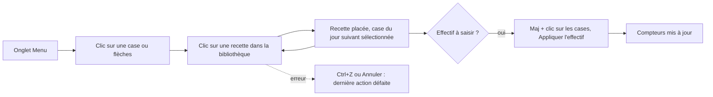
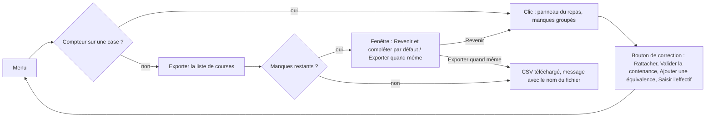
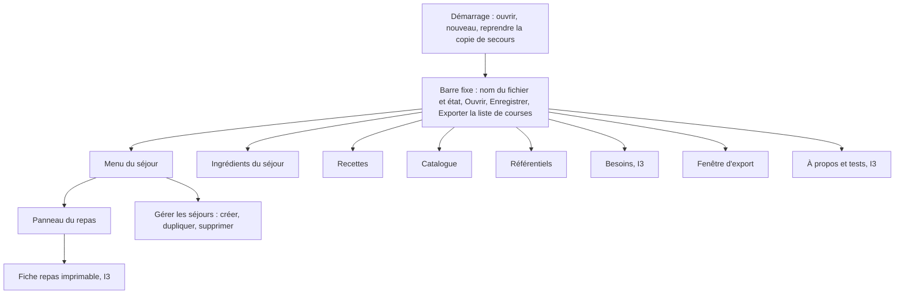

# UX/UI Spec — Menus et courses de séjour

2026-10-25 · @Houssam

## Résumé

L'interface sert un seul utilisateur, le responsable intendance (aussi concepteur), sur grand écran ; les cuisiniers reçoivent une fiche imprimée. Elle compte six onglets (Menu, Ingrédients du séjour, Recettes, Catalogue, Référentiels, Besoins), un écran de démarrage, une fenêtre d'export et une fiche repas A4. L'écran Menu suit le zoning B : bibliothèque de recettes à gauche, jours en lignes, panneau du repas à droite, avec un compteur sur chaque case qui mène à la correction. La direction visuelle « Brigade » (vert basilic, Barlow, cases en forme de bons de cuisine) a des tokens clairs et sombres vérifiés AA. **Le test d'usabilité n'a pas encore eu lieu** : il se fera par le demandeur, sur le premier incrément construit.

## Références

- Solution Design Spec — Menus et courses de séjour (25 oct. 2026) : F-01 à F-14, US-01 à US-16, SEC-01 à SEC-08, ENF-01 à ENF-07, ADR-01 à ADR-10.

- Discovery Brief — Menus et courses de séjour (24 oct. 2026) : rôles, TO-BE, glossaire.

- Fichiers du demandeur : catalogue de produits et export de liste de courses (données de la maquette).

**Contraintes de l'outil** : fichier HTML local ouvert en `file://`, sans serveur ; aucune ressource chargée depuis Internet, donc polices et icônes intégrées au fichier (SEC-08) ; Chrome, Edge et Firefox récents ; grand écran (1920 px ou plus) \[Fait\], mais utilisable à partir de 1280 px ; impression A4 portrait (ENF-07). Pas d'identité visuelle imposée \[Fait\].

## Contexte par rôle

| Rôle                                | Objectif                                                       | Situation et appareil                                                                                  | Fréquence                             | Aisance numérique                           | Ce qui peut le mettre en difficulté                                          |
|-------------------------------------|----------------------------------------------------------------|--------------------------------------------------------------------------------------------------------|---------------------------------------|---------------------------------------------|------------------------------------------------------------------------------|
| Responsable intendance / concepteur | Obtenir une liste de courses juste sans calcul manuel          | Au calme, plusieurs semaines avant le séjour, sur grand écran \[Fait\] ; souvent le soir \[Hypothèse\] | Sessions répétées avant chaque séjour | Très élevée \[Hypothèse : builder Anaplan\] | Perdre son travail ; un manque invisible ; valider 251 contenances une à une |
| Cuisiniers                          | Préparer le repas avec les bonnes quantités et le bon matériel | En cuisine, mains occupées, sur papier                                                                 | À chaque repas                        | Indifférente (papier)                       | Chiffres petits ou ambigus, unités peu claires                               |

Les coursiers et le gestionnaire du stock n'utilisent pas cet outil : ils passent par l'outil de courses.

## Tâches prioritaires et parcours

Les tâches fréquentes sont optimisées pour la vitesse, les tâches critiques pour la sûreté (ordre validé par le demandeur).

| Tâche                                          | F-xx       | Fréquence        | Criticité  | Objectif                                           |
|------------------------------------------------|------------|------------------|------------|----------------------------------------------------|
| Placer une recette et un effectif              | F-08       | Très haute       | Moyenne    | 1 clic par case, enchaînement automatique, clavier |
| Rattacher un ingrédient                        | F-09       | Haute            | Haute      | Recherche, dernier choix proposé                   |
| Saisir une recette                             | F-01, F-04 | Haute au début   | Moyenne    | Saisie en ligne, conversion visible                |
| Corriger les manques puis exporter             | F-10, F-12 | 1 à 2 par séjour | Très haute | Chaque manque mène à sa correction                 |
| Enregistrer, rouvrir                           | F-13       | Chaque session   | Très haute | État toujours visible                              |
| Importer le catalogue, valider les contenances | F-05, F-06 | Rare             | Haute      | Lot avec validation explicite                      |

**P1 — Composer le menu** (2 actions par case)

**P2 — Compléter puis exporter** (le parcours critique)

**P3 — Premier démarrage** : Démarrage → Nouveau fichier → Catalogue → Importer → aperçu → Confirmer → trier par « À saisir » → saisir les contenances illisibles → cocher les propositions relues → Valider la sélection → Enregistrer.

**P4 — Reprise** : rouvrir l'outil → copie de secours proposée avec sa date → Reprendre la copie ou Ignorer et ouvrir un fichier → Enregistrer.

## Architecture de l'information

Une barre fixe et six onglets ; l'écran Menu est l'écran par défaut après ouverture d'un fichier.

- Un seul rôle voit l'outil ; aucun écran n'est restreint (matrice des droits de la Design Spec).

- Les onglets Ingrédients du séjour, Menu et l'export portent le nombre d'éléments à compléter du séjour ouvert.

- « Gérer les séjours » s'ouvre depuis le sélecteur de séjour, en haut de l'onglet Menu.

- Onglets de l'incrément I3 (Besoins, À propos) masqués tant qu'ils ne sont pas construits.

## Inventaire des écrans

Chaque écran sert au moins une story ; l'action principale est le seul bouton vert plein de sa zone.

### Barre fixe (tous les écrans)

- **Affiche** : nom du fichier ; état « ● Non enregistré » ou « ✓ Enregistré à HH:MM » (SEC-01).

- **Actions** : Ouvrir, Enregistrer (Ctrl+S), **Exporter la liste de courses**.

- **États** : aucun fichier (Démarrage) ; enregistré ; non enregistré ; fermeture avec modifications → avertissement du navigateur.

### Démarrage (F-13, US-08)

- **Affiche** : invitation à ouvrir le fichier ; carte de reprise si une copie de secours existe (date, séjour, volume).

- **Action principale** : Ouvrir un fichier ; dans la carte, Reprendre la copie.

- **États** : aucune copie ; copie disponible ; fichier refusé (SEC-05, message rouge, données intactes) ; première utilisation (Nouveau fichier).

### Menu du séjour (F-07, F-08, F-10, US-04, US-06)

- **Affiche, par ordre** : nom du séjour et résumé des manques ; grille jours (lignes, J1…Jn) × moments (colonnes) ; bibliothèque à gauche ; panneau du repas à droite.

- **Case** : recette, effectif en gros chiffre, compteur « △ n » ; case sélectionnée : fond vert pâle + bordure épaisse + annonce « sélectionnée ».

- **Actions** : **placer une recette** (clic dans la bibliothèque) ; sélection multiple ; Appliquer l'effectif ; Annuler (grille seulement) ; Gérer les séjours.

- **États** : aucun séjour (« Créez votre premier séjour ») ; grille vide (cases « + Placer une recette ») ; bibliothèque vide (lien vers Recettes) ; manques (pastille orange, résumé) ; complet (« ✓ Menu complet, prêt à exporter ») ; effectif manquant (« Effectif ? ») ; Annuler désactivé sans historique.

- **Règles visibles** : RM-02, F-10 ; ADR-06 (recette modifiée → menu suit).

### Panneau du repas (F-09, F-10, F-14)

- **Affiche** : J + moment, recette, champ Effectif, bloc « △ n à compléter » (un bouton de correction par manque), ingrédients à l'effectif (RM-01), matériel.

- **Action principale** : la correction du premier manque ; sinon Imprimer la fiche.

- **États** : case vide ; repas complet (« ✓ Repas complet ») ; effectif invalide (champ rouge + « Saisissez un nombre entier, par exemple 42. ») ; plusieurs cases sélectionnées (panneau réduit à « Effectif à appliquer »).

### Ingrédients du séjour (F-09, US-05, US-12)

- **Affiche** : tableau Ingrédient / Utilisé dans / Produit rattaché / Statut ; filtre « △ À compléter » ; fenêtre de rattachement à droite.

- **Action principale** : Rattacher (ou Reprendre ce produit, si un dernier produit est connu).

- **États** : tout prêt ; non rattaché ; contenance à valider ; sans conversion ; produit introuvable ; aucun résultat de recherche (message + renvoi vers Catalogue) ; produit « En attente de validation » (badge bleu).

- **Règles visibles** : RM-06 (texte « Un seul produit par ingrédient pour ce séjour »), RM-07, ADR-09.

### Recettes (F-01 à F-04, US-03, US-09, US-10)

- **Affiche** : liste filtrable ; éditeur : nom, étiquettes, lignes (ingrédient, quantité pour 10, unité, conversion), matériel avec suggestions ; origine si variante.

- **Action principale** : Nouvelle recette ; dans l'éditeur, les modifications s'appliquent directement (pas de bouton d'enregistrement propre à la recette ; l'état global passe à « non enregistré »).

- **États** : bibliothèque vide ; ligne invalide (quantité ≤ 0) ; équivalence manquante (△ + lien) ; suppression refusée (recette utilisée, séjours listés) ; variante (origine affichée) ; aucun résultat de recherche.

### Catalogue (F-05, F-06, US-01, US-02)

- **Affiche** : dernier import ; aperçu d'import ; tableau des contenances (illisibles en tête) ; sous-catégories frais.

- **Action principale** : Importer le catalogue ; dans le tableau, Valider la sélection (n).

- **États** : jamais importé (« Importez le catalogue de votre outil de courses pour rattacher des produits. ») ; aperçu à confirmer ; import refusé (colonne manquante, code en double) ; import réussi ; contenance à saisir, proposée, saisie, format non reconnu, validée ; validation revenue à faire après changement d'unité.

### Référentiels (F-04)

- **Affiche** : ingrédients et leurs équivalences. **Action** : Ajouter une équivalence. **États** : vide ; doublon refusé. \[Non maquetté : même modèle que le tableau Ingrédients.\]

### Fenêtre d'export (F-12, US-07)

- **Affiche** : résumé ; liste des manques par repas ; conséquence de « Exporter quand même ».

- **Actions** : **Revenir et compléter** (par défaut, focus initial), Exporter quand même ; sans manque : Exporter, Fermer.

- **États** : complet ; manques ; succès (message avec le nom du fichier).

### Fiche repas (F-14, US-14)

- A4 portrait, noir et blanc ; séjour, jour, moment, recette, effectif en grand, ingrédients à l'effectif, matériel, zone de notes, date d'impression.

### Besoins (F-11, US-13, I3)

- Trois vues : par repas, par jour, par produit ; mêmes chiffres que l'export ; manques signalés. \[Non maquetté.\]

## Modèles d'interaction

Un seul modèle par usage, appliqué partout.

| Usage                             | Modèle                                                                                                                                                                           |
|-----------------------------------|----------------------------------------------------------------------------------------------------------------------------------------------------------------------------------|
| Saisie et validation d'un champ   | Validation à la sortie du champ ; bordure rouge 2 px + icône ✕ + message sous le champ (problème + correction), relié au champ ; la valeur fautive n'est pas appliquée           |
| Liste longue (recettes, produits) | Champ de recherche avec résultats filtrés au fil de la frappe ; flèches haut/bas + Entrée ; nombre de résultats annoncé                                                          |
| Composer la grille                | Clic ou Entrée sur une case = sélection ; clic sur une recette = placement dans la ou les cases sélectionnées, puis sélection du jour suivant ; aucun glisser-déposer nécessaire |
| Sélection multiple                | Maj + clic sur des cases ; Maj + flèches au clavier ; panneau « n cases sélectionnées »                                                                                          |
| Annuler                           | Bouton « ↶ Annuler (dernière action) » + Ctrl+Z, dans la grille seulement (placer, remplacer, vider, appliquer un effectif) ; désactivé sans historique ; message « Annulé : … » |
| Alerte non bloquante              | Pastille « △ n » (fond ambre, texte brun, bordure) + détail texte dans le panneau ; jamais la couleur seule                                                                      |
| Blocage                           | Message rouge « ✕ … » près de l'action refusée, avec la raison et la voie de sortie                                                                                              |
| Action irréversible               | Fenêtre de confirmation, bouton nommé par le verbe (« Supprimer le séjour »), focus initial sur « Annuler »                                                                      |
| Succès                            | Message bref en bas de l'écran, 5 s, annoncé aux lecteurs d'écran                                                                                                                |
| Enregistrement                    | État permanent dans la barre ; Ctrl+S ; nom daté proposé (SEC-03)                                                                                                                |
| Export                            | Fenêtre de contrôle ; « Revenir et compléter » par défaut ; « Revenir » sélectionne le premier repas incomplet                                                                   |
| Import                            | Aperçu chiffré à confirmer, rien n'est modifié avant « Confirmer l'import »                                                                                                      |
| Validation par lot                | Cases à cocher actives seulement si la valeur est au bon format ; « Valider la sélection (n) »                                                                                   |
| Fenêtres                          | Échap ferme ; focus piégé dans la fenêtre ; retour du focus sur le bouton d'origine                                                                                              |

## Direction visuelle et tokens

Direction retenue : **Brigade**, l'univers de la cuisine collective. L'élément marquant est la case du menu dessinée comme un bon de cuisine (bord supérieur en pointillé, effectif en gros chiffre condensé) ; tout le reste reste sobre. Les alternatives Carnet quadrillé et Inox sont écartées (25 oct. 2026).

**Typographie** : Barlow Condensed (titres, chiffres d'effectif ; 500, 600, 700) et Barlow (texte ; 400, 500, 600), licence SIL Open Font License, intégrées au fichier en woff2 (SEC-08) ; repli `system-ui, sans-serif`.

| Style                  | Police           | Taille / interligne | Graisse   |
|------------------------|------------------|---------------------|-----------|
| Titre d'écran          | Barlow Condensed | 28 px / 1,1         | 700       |
| Titre de bloc          | Barlow Condensed | 20–22 px / 1,2      | 600       |
| Effectif dans une case | Barlow Condensed | 20 px / 1           | 700       |
| Texte courant          | Barlow           | 15 px / 1,45        | 400       |
| Libellé de champ       | Barlow           | 14 px / 1,3         | 600       |
| Aide, métadonnées      | Barlow           | 13 px / 1,35        | 400       |
| Fiche imprimée         | Barlow           | 19 px (≥ 12 pt)     | 400 / 600 |

**Couleurs** (clair / sombre, le sombre suit le système)

| Token                                            | Clair                          | Sombre                         | Rôle                                      |
|--------------------------------------------------|--------------------------------|--------------------------------|-------------------------------------------|
| `bg`                                             | \#F4F6F3                       | \#172019                       | Fond de page                              |
| `surface`                                        | \#FFFFFF                       | \#1F2A22                       | Panneaux, cases, tableaux                 |
| `surface-muted`                                  | \#E8ECE9                       | \#2A362D                       | En-têtes de tableau, désactivé            |
| `chrome`                                         | \#18211B                       | \#0F1511                       | Barre fixe                                |
| `text`                                           | \#18211B                       | \#E8EEE9                       | Texte principal                           |
| `text-muted`                                     | \#4A5750                       | \#A9B6AD                       | Texte secondaire                          |
| `border`                                         | \#C9D1CB                       | \#3A4A3F                       | Bordures décoratives (cartes)             |
| `border-strong`                                  | \#7A877F                       | \#6F8276                       | Bordures de champs et contrôles           |
| `primary`                                        | \#2D6A43                       | \#6FBF8A                       | Action principale, sélection              |
| `on-primary`                                     | \#FFFFFF                       | \#0E1A12                       | Texte sur `primary`                       |
| `primary-subtle`                                 | \#E3EFE6                       | \#24402D                       | Case sélectionnée, succès                 |
| `success-text`                                   | \#1F4D30                       | \#9FD8B0                       | Texte de succès                           |
| `warning-bg` / `warning-text` / `warning-border` | \#FFF1D6 / \#7A4A00 / \#B07A1A | \#3A2E12 / \#F2C46B / \#C9963A | Manques, à compléter                      |
| `danger` / `danger-bg` / `danger-text`           | \#B3261E / \#FCE8E6 / \#8C1D18 | \#F4A29C / \#3B1A18 / \#F4A29C | Erreurs, blocages                         |
| `info-bg` / `info-text`                          | \#E6EEF7 / \#1F4A75            | \#1B2A3A / \#9CC3EE            | « En attente de validation », proposition |
| `focus`                                          | \#1F5FBF                       | \#8AB4F8                       | Contour de focus 3 px, décalé de 2 px     |

**Espacements** : base 4 px ; 4, 8, 12, 16, 20, 24, 32. **Rayons** : 6 px (contrôles), 8 px (cartes, panneaux), arrondi complet (pastilles) ; case du menu 0 en haut, 8 px en bas. **Ombre** : seulement sous les fenêtres (0 8px 30px, 25 %). **Cibles** : 40 px de haut minimum pour les boutons, 36 px pour les boutons secondaires des tableaux.

**Contrastes vérifiés** (WCAG 2.2, calcul du 25 oct. 2026)

| Couple                                         | Clair                     | Sombre      | Exigence                |
|------------------------------------------------|---------------------------|-------------|-------------------------|
| `text` sur `bg` / `surface`                    | 15,2 / 16,5               | 14,2 / 12,6 | 4,5                     |
| `text-muted` sur `surface`                     | 7,6                       | 7,1         | 4,5                     |
| `on-primary` sur `primary`                     | 6,5                       | 8,1         | 4,5                     |
| `primary` (lien, bouton contour) sur `surface` | 6,5                       | 6,7         | 4,5                     |
| `warning-text` sur `warning-bg`                | 6,7                       | 8,2         | 4,5                     |
| `warning-border` sur `surface`                 | 3,7                       | 5,6         | 3 (élément d'interface) |
| `danger-text` sur `danger-bg`                  | 7,7                       | 7,8         | 4,5                     |
| `danger` sur `surface`                         | 6,5                       | 7,4         | 4,5                     |
| `info-text` sur `info-bg`                      | 7,8                       | 8,0         | 4,5                     |
| `success-text` sur `primary-subtle`            | 8,2                       | 9,7         | 4,5                     |
| `border-strong` sur `surface`                  | 3,8                       | 3,6         | 3                       |
| `focus` sur `surface`                          | 6,1                       | 7,1         | 3                       |
| État de fichier sur `chrome`                   | 10,1 (ambre), 10,2 (vert) | idem        | 4,5                     |

Correction faite : `warning-border` est passé de \#C98A1E (2,9:1, échec) à \#B07A1A. `border` (1,6:1) reste réservé aux bordures décoratives ; aucun contrôle n'est identifié par lui seul.

## Maquette

[Maquette — Menus et courses de séjour](https://claude.ai/artifact/XLdFtg2PJBveYwbtC1Hbsi) (canevas de design, privé jusqu'à partage).

| Artboard              | Contenu                                                                                                                           | Interactif | Parcours couverts |
|-----------------------|-----------------------------------------------------------------------------------------------------------------------------------|------------|-------------------|
| Zoning A, Zoning B    | Deux dispositions de l'écran Menu (B retenu)                                                                                      | Non        | —                 |
| Directions 1 à 3      | Brigade (retenue), Carnet quadrillé, Inox                                                                                         | Non        | —                 |
| Menu du séjour        | Sélection, placement en chaîne, sélection multiple et effectif, annulation, panneau des manques, fenêtre d'export, enregistrement | Oui        | P1, P2            |
| Ingrédients du séjour | Filtre, rattachement, dernier produit, recherche, aucun résultat                                                                  | Oui        | P2                |
| Catalogue             | Aperçu d'import, contenances par lot, formats invalides, sous-catégories frais                                                    | Oui        | P3                |
| Recettes              | Éditeur, conversions, erreur de ligne, équivalence manquante, suppression refusée, suggestions de matériel                        | Non        | P1 (amont)        |
| Démarrage             | Reprise de la copie de secours, fichier refusé                                                                                    | Non        | P4                |
| Fiche repas           | A4 imprimable                                                                                                                     | Non        | Cuisiniers        |

Données : séjour « Jupiter été », 7 jours, 4 moments, 38 à 45 personnes, produits tirés du catalogue fourni ; quelques codes produits sont fictifs (ex. ALM-V01) pour illustrer des cas. Non maquettés : Référentiels, Besoins, Gérer les séjours, mode sombre (tokens fournis).

## Textes de l'interface

Ton direct, phrases courtes, termes du glossaire. Une action garde le même nom du bouton au message de succès.

**Libellés fixes**

| Élément               | Texte                                                                                   |
|-----------------------|-----------------------------------------------------------------------------------------|
| Onglets               | Menu ; Ingrédients du séjour ; Recettes ; Catalogue ; Référentiels ; Besoins            |
| Barre                 | Ouvrir ; Enregistrer ; Exporter la liste de courses                                     |
| État du fichier       | ● Non enregistré ; ✓ Enregistré à 21:58                                                 |
| Case vide             | \+ Placer une recette                                                                   |
| Effectif manquant     | Effectif ?                                                                              |
| Compteur              | △ 3 (lecteur d'écran : « 3 éléments à compléter »)                                      |
| Résumé du séjour      | △ 9 à compléter dans 4 repas ; ✓ Menu complet, prêt à exporter                          |
| Statuts d'ingrédient  | Non rattaché ; Contenance à valider ; Sans conversion ; Produit introuvable ; ✓ Prêt    |
| Statuts de contenance | △ À saisir ; Proposée, à valider ; Saisie, à valider ; ✕ Format non reconnu ; ✓ Validée |

**Messages d'erreur et de blocage** (problème + correction)

| Cas                        | Message                                                                                                                                                                                                                            |
|----------------------------|------------------------------------------------------------------------------------------------------------------------------------------------------------------------------------------------------------------------------------|
| Effectif invalide          | Saisissez un nombre entier, par exemple 42.                                                                                                                                                                                        |
| Quantité ≤ 0               | ✕ La quantité doit être supérieure à 0. Saisissez la quantité pour 10 personnes, ou supprimez la ligne.                                                                                                                            |
| Contenance illisible       | ✕ Format non reconnu. Écrivez un nombre et une unité : 500 g, 1,5 l, 10 pièces.                                                                                                                                                    |
| Recette utilisée           | ✕ Impossible de supprimer « Tajine de poulet » : elle est utilisée dans les séjours Jupiter été (J2 Dîner) et Printemps (J4 Dîner). Retirez-la de ces menus, ou créez une variante si vous voulez la modifier pour un seul séjour. |
| JSON refusé                | ✕ Le fichier « menus_ancien.json » n'a pas été ouvert : son format (version 0) n'est pas reconnu. Vos données actuelles n'ont pas été modifiées. Ouvrez un fichier enregistré par cet outil.                                       |
| Import : colonne manquante | ✕ Import refusé : la colonne « Code » est absente. Exportez de nouveau le catalogue depuis l'outil de courses, sans modifier les en-têtes.                                                                                         |
| Import : code en double    | ✕ Import refusé : le code ALM-133 apparaît deux fois. Corrigez le fichier dans l'outil de courses.                                                                                                                                 |
| Aucun produit trouvé       | Aucun produit ne correspond à « olive ». Vérifiez l'orthographe ou importez un catalogue à jour dans l'onglet Catalogue.                                                                                                           |
| Nom d'ingrédient en double | ✕ L'ingrédient « Oignon » existe déjà. Choisissez-le dans la liste.                                                                                                                                                                |

**Confirmations et succès**

| Cas                       | Texte                                                                                                                                                                                                                                                               |
|---------------------------|---------------------------------------------------------------------------------------------------------------------------------------------------------------------------------------------------------------------------------------------------------------------|
| Export avec manques       | Titre : Exporter la liste de courses. Boutons : Revenir et compléter ; Exporter quand même. Aide : « Si vous continuez : les ingrédients non rattachés et les repas sans effectif ne sont pas exportés ; les lignes sans conversion sont marquées « À vérifier ». » |
| Export réussi             | ✓ Liste de courses exportée : liste-courses_Jupiter-ete_2026-10-25.csv                                                                                                                                                                                              |
| Enregistré                | ✓ Enregistré : menus_2026-10-25_2158.json                                                                                                                                                                                                                           |
| Import réussi             | ✓ Catalogue importé : 3 produits ajoutés, 12 modifiés, 1 absent signalé.                                                                                                                                                                                            |
| Annulation                | ✓ Annulé : placer « Harira »                                                                                                                                                                                                                                        |
| Supprimer un séjour       | Titre : Supprimer le séjour « Jupiter été » ? Texte : Ses 28 repas et ses rattachements seront supprimés. Les recettes restent dans la bibliothèque. Boutons : Annuler ; Supprimer le séjour                                                                        |
| Reprise                   | △ Travail non enregistré retrouvé. Boutons : Reprendre la copie ; Ignorer et ouvrir un fichier                                                                                                                                                                      |
| Fermeture non enregistrée | Avertissement standard du navigateur (texte non personnalisable)                                                                                                                                                                                                    |

**États vides** (ce qui manque + première action)

| Écran                      | Texte                                                                                              | Action                  |
|----------------------------|----------------------------------------------------------------------------------------------------|-------------------------|
| Menu sans séjour           | Aucun séjour dans ce fichier. Créez-en un pour composer le menu.                                   | Créer un séjour         |
| Bibliothèque vide          | Aucune recette. Créez votre première recette pour 10 personnes.                                    | Nouvelle recette        |
| Catalogue jamais importé   | Importez le catalogue de votre outil de courses pour rattacher des produits.                       | Importer le catalogue   |
| Ingrédients du séjour vide | Les ingrédients apparaîtront ici dès qu'une recette sera placée dans le menu.                      | Aller au menu           |
| Référentiels vide          | Aucune équivalence. Ajoutez-en une pour convertir des pièces en grammes, par exemple 1 œuf = 60 g. | Ajouter une équivalence |
| Panneau, case vide         | Case vide. Cliquez sur une recette à gauche pour la placer ici.                                    | —                       |

## Accessibilité

Contrôle WCAG 2.2 AA fait sur la maquette (pré-contrôle de conception, à refaire sur l'outil construit) : aucun problème bloquant restant ; deux exigences de construction ajoutées.

| Point                                          | Résultat               | Mesure                                                                                                                                             |
|------------------------------------------------|------------------------|----------------------------------------------------------------------------------------------------------------------------------------------------|
| Contraste du texte ≥ 4,5:1                     | Passe                  | Tous les couples de la section Tokens, clair et sombre                                                                                             |
| Contraste des éléments d'interface ≥ 3:1       | Passe après correction | `warning-border` assombri ; champs en `border-strong` (3,8:1)                                                                                      |
| Information jamais portée par la couleur seule | Passe                  | △, ✕, ✓ et texte ; case sélectionnée = bordure épaisse + annonce                                                                                   |
| Cibles ≥ 24 × 24 px                            | Passe                  | Boutons 36 à 48 px de haut ; cases à cocher 22 px dans une ligne de 36 px                                                                          |
| Clavier                                        | À construire           | Grille en motif « grille » ARIA : un seul arrêt de tabulation, flèches entre cases, Entrée pour chercher, Maj + flèches pour la sélection multiple |
| Focus visible et non masqué                    | Passe                  | Contour `focus` 3 px ; le panneau de droite ne recouvre jamais la case active                                                                      |
| Alternative au glisser-déposer                 | Passe                  | Aucun glisser-déposer requis                                                                                                                       |
| Structure des titres                           | Passe                  | h1 par écran, h2 par bloc                                                                                                                          |
| Libellés associés aux champs                   | Passe                  | `label` ou nom accessible ; messages d'erreur reliés au champ                                                                                      |
| Ordre de lecture                               | Passe                  | Barre, onglets, bibliothèque, grille, panneau                                                                                                      |
| Fenêtres                                       | À construire           | Focus piégé, Échap, focus initial sur l'action sûre, retour du focus                                                                               |
| Messages de statut                             | Passe                  | Succès annoncés (région de statut) ; erreurs bloquantes en alerte                                                                                  |
| Pas de ressaisie                               | Passe                  | Effectif recopiable sur plusieurs cases ; dernier produit proposé                                                                                  |
| Textes alternatifs                             | Sans objet             | Pas d'image ; icônes décoratives masquées, texte toujours présent                                                                                  |
| Zoom 200 %                                     | À vérifier             | Mise en page fluide ; à tester sur l'outil construit                                                                                               |

## Évaluation heuristique

Revue sur les 10 heuristiques de Nielsen : 8 problèmes trouvés, 2 majeurs et 2 mineurs corrigés dans la maquette, 3 transformés en exigences de construction et 1 en question ouverte ; aucun bloquant restant.

| \#  | Heuristique                       | Problème                                                                          | Gravité | Correction                                                                                                              |
|-----|-----------------------------------|-----------------------------------------------------------------------------------|---------|-------------------------------------------------------------------------------------------------------------------------|
| H1  | Prévention des erreurs            | « Annuler » restait actif sans historique                                         | Mineur  | Désactivé sans historique (maquette corrigée)                                                                           |
| H2  | Cohérence                         | « Annuler » servait à la fois à défaire et à fermer la fenêtre d'export           | Majeur  | Fenêtre sans manque : « Fermer » (maquette corrigée)                                                                    |
| H3  | Visibilité de l'état              | Placer une recette dans une case vide sans effectif ne le signalait qu'après coup | Mineur  | « Effectif ? » dans la case et compteur immédiat (déjà en maquette)                                                     |
| H4  | Contrôle et liberté               | Le placement en chaîne passe au jour suivant : risque d'écraser une case remplie  | Majeur  | Une case remplie est remplacée mais annulable (Ctrl+Z) ; message « Remplacé : … » à afficher (exigence de construction) |
| H5  | Reconnaissance plutôt que mémoire | Les raccourcis clavier ne sont visibles que dans une ligne d'aide                 | Mineur  | Garder la ligne d'aide sous la grille ; infobulle sur les boutons                                                       |
| H6  | Aide à la récupération            | « Revenir et compléter » devait mener au manque                                   | Majeur  | La fenêtre sélectionne le premier repas incomplet (déjà en maquette)                                                    |
| H7  | Design minimaliste                | 251 contenances visibles d'un coup = surcharge                                    | Majeur  | Tri par statut, illisibles en tête, filtre « À valider » (exigence de construction)                                     |
| H8  | Correspondance avec le monde réel | « 8,4 pièces » sur la fiche imprimée n'a pas de sens en cuisine                   | Mineur  | Question renvoyée (arrondi d'affichage des pièces)                                                                      |

## Plan de test d'usabilité

**Statut : pas encore réalisé.** Le demandeur est le seul utilisateur réel ; il testera lui-même sur l'incrément I1 construit plutôt que sur la maquette (décision du 25 oct. 2026). Un auto-test est moins fiable qu'un test avec un tiers : le répéter à une semaine d'écart, et noter les hésitations au moment où elles arrivent.

**Déroulement** : deux sessions de 45 minutes, la seconde une semaine plus tard. Pendant chaque scénario, verbaliser à voix haute ou noter en direct ce qu'on cherche ; ne pas consulter cette spec.

**Scénarios** (des situations, pas des instructions)

1.  Le séjour d'été dure 7 jours, avec 4 repas par jour. Le premier jour, vous serez 38 ; ensuite 42, puis 45 à partir du J5. Préparez le menu de la semaine à partir de vos recettes.

2.  Vous venez d'ajouter un tajine au dîner du J2, mais la liste de courses ne doit rien oublier. Faites en sorte que le menu soit complet.

3.  Vous recevez une nouvelle version du catalogue de votre outil de courses. Mettez-le à jour et assurez-vous que les nouveaux produits pourront être arrondis correctement.

4.  Cinq personnes arrivent plus tôt : le déjeuner et le dîner du J1 passent à 43. Ajustez, puis envoyez la liste à l'outil de courses.

5.  Votre ordinateur s'est éteint pendant que vous travailliez. Reprenez là où vous en étiez.

**Mesures et grille**

| Scénario                     | Réussi (oui / avec aide / non) | Erreurs | Hésitations (où) | Temps approx. | Commentaires |
|------------------------------|--------------------------------|---------|------------------|---------------|--------------|
| 1 Composer la semaine        |                                |         |                  |               |              |
| 2 Compléter un repas         |                                |         |                  |               |              |
| 3 Mettre à jour le catalogue |                                |         |                  |               |              |
| 4 Ajuster puis exporter      |                                |         |                  |               |              |
| 5 Reprendre après coupure    |                                |         |                  |               |              |

**Pré-contrôle par l'équipe de conception** (revue pas à pas, ne remplace pas le test) : scénarios 2 et 4 fluides dans la maquette ; scénario 1 : la saisie d'effectifs différents par jour demande une sélection multiple par ligne, à surveiller ; scénario 3 : la validation des 251 contenances reste la tâche la plus longue.

**Après le test** : classer chaque problème (bloquant, majeur, mineur), corriger la maquette et cette spec, puis rejouer les scénarios concernés.

## Écarts renvoyés à l'Architect

Aucun écart ne change le modèle de données ni les règles ; trois compléments d'interface sont à enregistrer dans la Design Spec.

| Écart                                                                        | Décision                                                                                              | Statut                                            |
|------------------------------------------------------------------------------|-------------------------------------------------------------------------------------------------------|---------------------------------------------------|
| Annuler la dernière action dans la grille (Ctrl+Z), absent de la Design Spec | Ajouté à l'interface, portée limitée à la grille ; historique en mémoire, non enregistré dans le JSON | Validé par le demandeur, à ajouter aux stories I1 |
| Placement en chaîne (sélection du jour suivant après placement)              | Comportement d'interface, sans effet sur les données                                                  | À ajouter aux critères d'US-04                    |
| Arrondi d'affichage des pièces sur la fiche repas (« 8,4 pièces »)           | Solution d'attente : afficher 1 décimale ; RM-01 inchangé                                             | Question ouverte, à arbitrer                      |

## Matrice de traçabilité

Le contrôle de complétude passe : chaque story avec interface a un écran, et chaque écran ses états vide, erreur et alerte.

| Story / F-xx      | Écran                                   | États visibles                                                   | Maquette                     |
|-------------------|-----------------------------------------|------------------------------------------------------------------|------------------------------|
| US-01, F-05       | Catalogue                               | Jamais importé, aperçu, refusé, réussi, produit absent           | Oui                          |
| US-02, F-06       | Catalogue                               | À saisir, proposée, saisie, format non reconnu, validée          | Oui                          |
| US-03, F-01, F-04 | Recettes                                | Vide, ligne invalide, équivalence manquante, conversion affichée | Oui                          |
| US-04, F-07, F-08 | Menu, Gérer les séjours                 | Aucun séjour, grille vide, effectif manquant, sélection multiple | Oui (sauf Gérer les séjours) |
| US-05, F-09       | Ingrédients du séjour, panneau du repas | Non rattaché, aucun résultat, en attente de validation           | Oui                          |
| US-06, F-10       | Menu, panneau du repas                  | Compteur, détail par type, repas complet, menu complet           | Oui                          |
| US-07, F-12       | Fenêtre d'export                        | Complet, manques, succès                                         | Oui                          |
| US-08, F-13       | Barre fixe, Démarrage                   | Non enregistré, enregistré, reprise, fichier refusé              | Oui                          |
| US-09, F-02       | Recettes                                | Variante (origine affichée)                                      | Oui                          |
| US-10, F-03       | Recettes, bibliothèque du Menu          | Recherche, aucun résultat                                        | Oui                          |
| US-11, F-07       | Gérer les séjours                       | Duplication, suppression confirmée                               | Texte seulement              |
| US-12, F-09       | Ingrédients du séjour                   | Dernier produit proposé                                          | Oui                          |
| US-13, F-11       | Besoins                                 | Vide, partiel                                                    | Non (I3)                     |
| US-14, F-14       | Fiche repas                             | A4                                                               | Oui                          |
| US-15             | Paramètres (Catalogue ou À propos)      | Tolérance                                                        | Non (I3)                     |
| US-16             | À propos                                | Versions                                                         | Non (I3)                     |
| SEC-01, SEC-02    | Barre fixe, Démarrage                   | Indicateur, reprise                                              | Oui                          |
| SEC-04            | Tous                                    | Texte importé rendu en texte ; liens http(s)                     | Règle de construction        |
| SEC-05, SEC-06    | Démarrage, Catalogue                    | Refus avec message                                               | Oui                          |

Rôles : le responsable voit tous les écrans ; les cuisiniers ne voient que la fiche imprimée. Libellés conformes au glossaire (séjour, moment, repas, recette, variante, ingrédient, produit, contenance, équivalence, rattachement, effectif, gros achat, frais).

## Questions ouvertes

| Question                                                                                                                | Impact                                                                           | Qui peut répondre            |
|-------------------------------------------------------------------------------------------------------------------------|----------------------------------------------------------------------------------|------------------------------|
| Comment afficher les pièces sur la fiche repas (8,4 pièces : arrondir au-dessus, afficher « ≈ 9 », garder 1 décimale) ? | Lisibilité en cuisine                                                            | Demandeur, cuisiniers        |
| Les effectifs varient-ils souvent à l'intérieur d'un même jour ?                                                        | Faut-il un raccourci « même effectif pour tout le jour » (clic sur l'en-tête J1) | Demandeur (test, scénario 1) |
| La validation des contenances par lot est-elle assez rapide pour 251 produits ?                                         | Effort du premier démarrage                                                      | Demandeur (test, scénario 3) |
| Où placer le réglage de tolérance d'arrondi (I3) ?                                                                      | Navigation                                                                       | Demandeur                    |
| Faut-il imprimer toutes les fiches d'un jour en une fois ?                                                              | Fonctionnalité hors Design Spec                                                  | Demandeur, Architect         |

## Transmission au Solution Builder

Construire I1 avec les tokens tels quels ; la maquette impose les parcours, les états et les textes, et reste indicative sur les pixels.

**Tokens** : reprendre exactement la section « Direction visuelle et tokens » sous forme de variables CSS (`--bg`, `--surface`, `--primary`…), avec une variante sombre activée par `prefers-color-scheme: dark`. Polices Barlow et Barlow Condensed intégrées en woff2 (sous-ensemble latin), licence notée dans À propos (SEC-08).

**Composants et états**

| Composant                                     | États                                                                           |
|-----------------------------------------------|---------------------------------------------------------------------------------|
| Bouton principal, secondaire, contour, danger | Normal, survol, focus, désactivé                                                |
| Case du menu                                  | Vide, remplie, sélectionnée, multi-sélectionnée, à compléter, effectif manquant |
| Pastille                                      | Alerte (△ n), succès (✓), info (en attente), erreur (✕)                         |
| Champ                                         | Normal, focus, erreur + message, désactivé                                      |
| Ligne de tableau                              | Normale, sélectionnée, à compléter                                              |
| Fenêtre                                       | Ouverte (focus piégé), fermeture Échap                                          |
| Message de statut                             | Succès 5 s ; erreur persistante jusqu'à correction                              |
| Indicateur de fichier                         | Aucun, enregistré, non enregistré                                               |

**Taille d'écran** : conçu pour 1920 px ; à partir de 1280 px, les trois colonnes du Menu restent côte à côte (bibliothèque 260 px, panneau 340 px) ; en dessous, le panneau passe sous la grille. Grilles de plus de 7 jours : défilement vertical, en-tête des moments fixe.

**Ordre de construction** (aligné sur les incréments) : I1 = barre fixe, Démarrage, Menu (grille, bibliothèque, panneau, Annuler), Ingrédients du séjour, Recettes (sans variantes), Catalogue, Référentiels, fenêtre d'export ; I2 = variantes, étiquettes et recherche, Gérer les séjours (dupliquer), dernier produit proposé, suggestions de matériel ; I3 = Besoins, fiche repas, tolérance, À propos.

**Imposé** : parcours P1 à P4 ; zoning B ; textes de l'interface ; modèles d'interaction ; tokens ; états de chaque écran. **Indicatif** : espacements exacts, largeurs de colonnes, détails de la fiche imprimée.

**Accessibilité à tester sur l'outil construit** : parcours P1 et P2 entièrement au clavier ; grille ARIA (un arrêt de tabulation, flèches) ; annonces des compteurs et des succès par un lecteur d'écran (NVDA ou VoiceOver) ; focus jamais masqué par le panneau ; zoom 200 % sans perte ; contrastes des deux thèmes.

## Sources

- WCAG 2.2, recommandation du W3C (référence pour les seuils de contraste, de cible et de focus ; non reconsultée dans cette session).

- Jakob Nielsen, 10 heuristiques d'utilisabilité, Nielsen Norman Group (référence ; non reconsultée dans cette session).

- [web.dev — Enregistrer un fichier](https://web.dev/articles/files/save-a-file?hl=es) : enregistrement direct sous Chrome/Edge, téléchargement ailleurs (mis à jour le 29 juil. 2026, consulté le 25 oct. 2026).

- Polices Barlow et Barlow Condensed, Google Fonts, licence SIL Open Font License \[licence à confirmer au moment de l'intégration\].

- Contrastes calculés selon la formule de luminance relative WCAG, le 25 oct. 2026.

- Fichiers du demandeur : catalogue de produits et export de liste de courses (25 oct. 2026).
